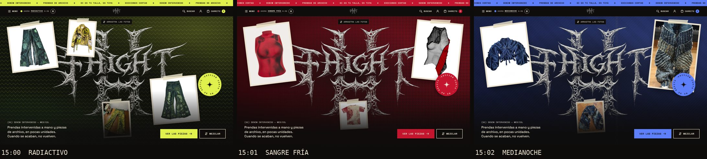
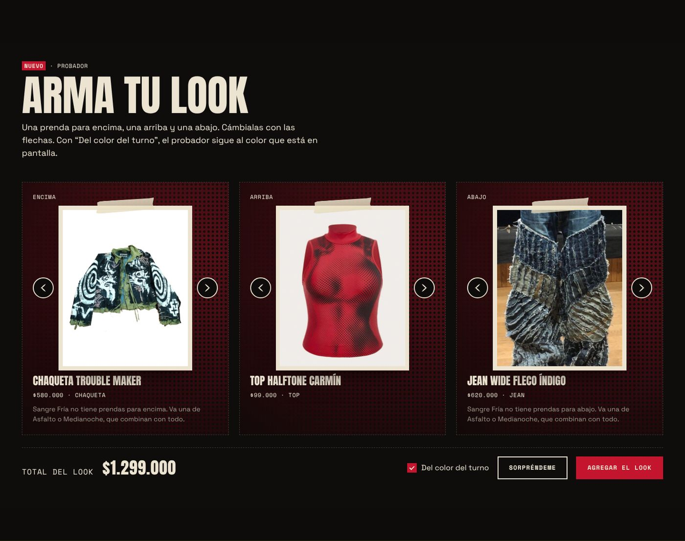
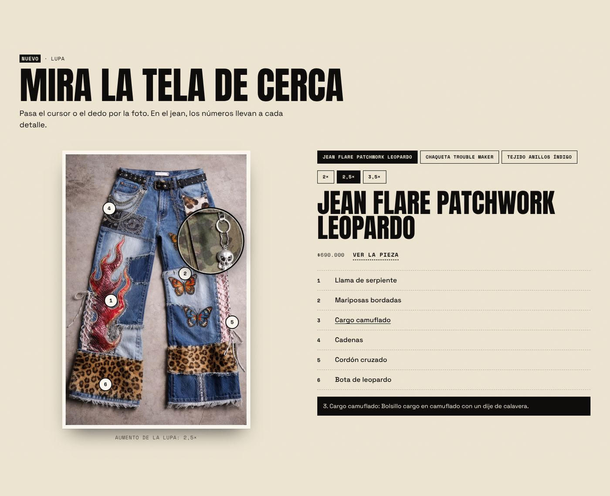
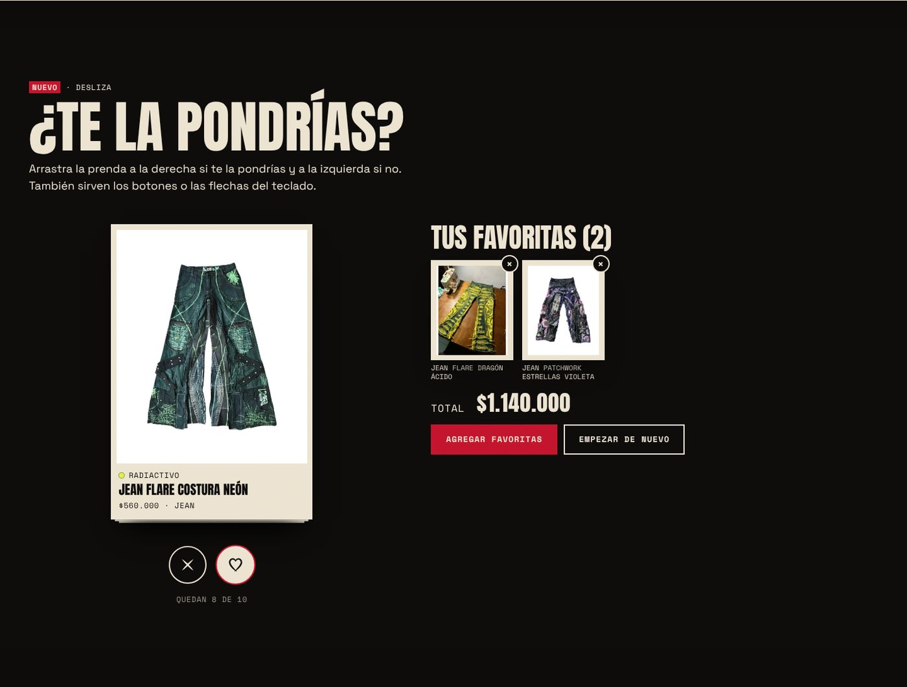

# Hight 2.0 — tema de Shopify

Tema Online Store 2.0 para **hight18.myshopify.com**. La versión 2.0 cambia la tienda por completo: colores,
tipografías y orden de las secciones salen de las prendas (denim intervenido, patchwork, tintes ácidos, malla) y
la página se volvió interactiva: las fotos se arrastran, las cintas de texto aceleran con el scroll, el visitante
elige el color de la tienda y cada pieza tiene su anatomía explicada punto por punto. Los colores salen de las
colecciones: cada color es una colección y, al abrirla, toda la tienda toma su color.


> Las capturas de `docs/preview/` se hicieron renderizando el Liquid del tema con las prendas reales de la tienda.
> La foto de la Chaqueta blood rose es un reemplazo de la vista previa: en la tienda se ve la foto real.

## Qué cambió

| | Hight 1.0 | Hight 2.0 |
| --- | --- | --- |
| Colores | Plata cepillada y aura (azul) | **Carbón** y **hueso** de base; **ácido** (Jean Dragón), **carmín** (Camiseta Célula), **índigo** (Jean Wide) y **leopardo** como acentos y fondos de sección |
| Tipografías | Archivo, IBM Plex Mono, Instrument Serif, Hight Espina | **Anton** (titulares gigantes), **Space Grotesk** (texto) y **Space Mono** (marquillas, precios, botones) |
| Motivos | Metal, cianotipo, halo | Fotos como copias impresas con cinta, costuras punteadas, grano de fotocopia y sellos que giran |
| Home | Hero, catálogo, spread, manifiesto | Hero collage → correas → Lo nuevo → Probador → Elige tu color → clóset → Anatomía de una pieza → Lupa → Desliza → Archivo → Lookbook → Manifiesto |

El logo gótico se mantiene: es la marca. El design system original sigue en [`design-system/`](design-system/README.md) como referencia.

## Lo interactivo

- **La tienda cambia de estilo cada minuto:** color, textura y prendas del collage van rotando por los 6 colores
  (más abajo, en [La tienda cambia de estilo cada minuto](#la-tienda-cambia-de-estilo-cada-minuto)).
- **Probador (Arma tu look):** una prenda para encima, una arriba y una abajo, con flechas, *Sorpréndeme*, el total
  del look y un botón que agrega las tres al carrito (con talla cuando la prenda tiene varias). Con *Del color del
  turno* sigue al color que está en pantalla; si ese color no tiene prenda para un puesto, va una de Asfalto o
  Medianoche y lo dice. Si alguien ya armó su look, el cambio de turno no se lo quita.
- **Lupa (Mira la tela de cerca):** una lupa redonda sigue al cursor o al dedo sobre la foto, con aumento 2×, 2,5× o
  3,5×. En el jean, los números llevan a cada detalle; la chaqueta tiene frente y espalda. La foto en alta se baja solo
  cuando alguien llega a la foto. Reemplaza en el home a *Anatomía de una pieza*, que sigue en el editor (apagada) por
  si se quiere volver a usar.
- **Desliza (¿Te la pondrías?):** las prendas salen una por una; a la derecha si te la pondrías, a la izquierda si
  no (arrastrando, con los botones o con las flechas del teclado). Las favoritas se guardan en el navegador, suman su
  total y se agregan juntas al carrito.
- **Vista 360:** cada prenda tiene un botón **360°** en su ficha y en las tarjetas del catálogo. La abre dibujada en
  vector, como sacada de Illustrator, con las texturas de su tela, para girarla en cualquier dirección (más abajo,
  en [Vista 360 de las prendas](#vista-360-de-las-prendas)).
- **Clóset:** en el inicio, todas las prendas con vista 360 colgadas en 3D de dos barras (arriba las de arriba, abajo
  jeans, pantalones y shorts). Se mueven solas y cada una gira al pasar; con el cursor encima se marca y el clóset va
  más lento. Al tocar una prenda se abre su vista 360. Tiene botón para pausar y, con el teclado, cada prenda es un
  botón. Cuelgan por nombre, o en el orden de la colección que se elija en la sección.
- **Correas:** debajo del hero, las 12 correas de tachas dibujadas en vector (`assets/correa-01.svg` a `-12.svg`,
  hechas con [`bocetos/correas/`](bocetos/correas/README.md)) corren en dos filas en sentidos contrarios sobre una
  franja del color de acento. Se mueven solas, van más lento con el cursor encima y se aceleran con el scroll; si el
  dispositivo pide menos movimiento, siguen moviéndose, pero despacio.
- **Hero collage:** el logo al centro y las prendas como fotos pegadas con cinta. En computador se arrastran y se
  mueven con el cursor; en el teléfono flotan. El botón **MEZCLAR** las reparte de nuevo.
- **Cintas de texto:** corren de lado a lado y aceleran cuando haces scroll.
- **Lo nuevo:** fila con las últimas piezas que entraron. Se arrastra con el mouse, tiene flechas y barra de avance.
  Las tarjetas se inclinan con el cursor y dejan **AGREGAR** al carrito sin entrar a la ficha (o elegir talla, en la
  camiseta).
- **Elige tu color:** cada color es una colección (Radiactivo, Sangre Fría, Medianoche, Chicle, Asfalto y Fiera). Al tocarlo,
  **toda la tienda se pinta** con ese color, se ven sus piezas como fotos apiladas y un botón lleva a la colección. El
  navegador lo recuerda y se puede volver al color original (con la rotación encendida, la tienda vuelve a
  cambiar sola).
- **Colecciones de color:** al entrar a una (desde el menú, el home o la fila de colores de cada colección), la
  tienda toma su color: botones, cintas, marquillas y el título gigante.
- **Anatomía de una pieza:** puntos numerados sobre el Jean Flare Patchwork Leopardo; cada uno abre su detalle.
- **Archivo:** índice de todas las piezas agrupadas por tipo (Chaquetas, Jeans, Tops…), con su cantidad, en dos
  columnas cuando caben. En computador la foto de cada pieza sigue al cursor; en tablet y teléfono cada fila lleva su
  miniatura. En *Diseño* se puede volver a la lista de nombres gigantes.
- **Manifiesto:** el texto se enciende palabra por palabra con el scroll.
- **Menú a pantalla completa** con foto al pasar por cada enlace; los colores llevan su punto y tiñen el menú.
  También: **zoom** de fotos en la ficha, **barra para comprar** cuando el botón queda arriba (abajo en el teléfono,
  como tarjeta en el computador), selector de **columnas** en la
  tienda, etiqueta junto al cursor (VER, ARRASTRA) y transición suave entre páginas.

Todo respeta la opción de reducir movimiento del teléfono o del computador, y se puede apagar en
*Configuración del tema > Movimiento*.


## Colecciones y colores

| Colección | Qué entra | Color | Dirección |
| --- | --- | --- | --- |
| Lo nuevo | Todas las piezas, de la más nueva a la más vieja (fila del home) | — | `/collections/lo-nuevo` |
| Pantalones | Tipo de producto Jean, Pantalón o Short | — | `/collections/pantalones` |
| Tops | Tipo Top o Camiseta | — | `/collections/tops` |
| Buzos y tejidos | Tipo Buzo, Tejido o Chaqueta | — | `/collections/buzos-y-tejidos` |
| **Radiactivo** | Etiqueta `Color Ácido`: amarillo neón y verdes sobreteñidos | `#dff04a` | `/collections/acido` |
| **Sangre Fría** | Etiqueta `Color Carmín`: rojo carmín | `#c3142d` | `/collections/carmin` |
| **Medianoche** | Etiqueta `Color Índigo`: índigo y azul noche | `#5b7cfa` | `/collections/indigo` |
| **Chicle** | Etiqueta `Color Magenta`: rosa, fucsia y violeta | `#e0218a` | `/collections/magenta` |
| **Asfalto** | Etiqueta `Color Ceniza`: grises, hueso y carbón | `#c4beb2` | `/collections/ceniza` |
| **Fiera** | Etiqueta `Color Leopardo`: animal print y tonos tierra | `#c08a4e` | `/collections/leopardo` |

Cada color tiene nombre propio, descripción y título para buscadores. Al cambiarles el nombre se dejaron igual la
dirección y la etiqueta, así que los enlaces viejos siguen funcionando y no hubo que volver a etiquetar las prendas.

Son colecciones automáticas: una prenda nueva entra sola si tiene el tipo o la etiqueta. El color se cambia en
*Productos > Colecciones > (colección) > Metacampos > Color de la colección*; con ese campo lleno, la colección
aparece con su punto en el menú, en la fila de colores y en la lista de colecciones, y pinta la tienda al abrirla.
El menú principal queda así: Tienda, Pantalones, Tops, Buzos y tejidos, Colores (con los 6 colores adentro) y
Contacto.


## La tienda cambia de estilo cada minuto

Al empezar cada minuto la tienda pasa al color siguiente: Radiactivo → Sangre Fría → Medianoche → Chicle → Asfalto
→ Fiera, y vuelve a empezar. Con el color cambian la textura del fondo del collage (zigzag ácido, semitono, sarga
índigo, camuflado, malla y leopardo) y las fotos del collage, que pasan a ser prendas disponibles de ese color.

- **No varía en el tiempo:** el turno sale de la hora, no de cuándo se abrió la página. Cambia en el segundo :00 de
  cada minuto, en el mismo orden y a la vez para todos los que estén en la tienda. Cada cambio se programa contra el
  reloj, así que no se atrasa aunque la página lleve horas abierta, y si la pestaña queda en segundo plano se pone al
  día al volver. En las pruebas, todos los cambios cayeron entre 31 y 51 milésimas después del segundo exacto.
- **Sin parpadeo ni descargas de más:** el color del turno se pinta antes de que se vea la página y el collage ya
  sale con las prendas del turno. Las fotos que el turno reemplaza no se descargan y las del turno siguiente se
  precargan durante el minuto.
- **Control en el encabezado,** al lado de MENÚ: AHORA, el nombre del color (lleva a su colección), cuánto falta para
  el siguiente y un botón para **pausar**. La pausa se recuerda en las otras páginas. En el teléfono quedan el punto y
  el botón.
- **Dónde no rota:** en la ficha y en el carrito se queda el color con el que se abrió la página, para no distraer al
  comprar. En las colecciones de color manda su propio color. En la página de contraseña sí rota, con el control
  debajo del texto.
- **Elige tu color manda:** si el visitante elige un color, la tienda se queda en ese (el control dice TU COLOR) y el
  botón QUE CAMBIE SOLO la pone a rotar otra vez. Con la rotación encendida, el color de la última colección abierta
  ya no se arrastra a las otras páginas.
- **El cambio no interrumpe:** el color entra con una transición de casi un segundo que no bloquea clics ni toques,
  y las fotos se reemplazan como copias que se cambian. Con *reducir movimiento* cambia sin animación.
- **El inicio dice el turno:** *(Turno 2/6) · Textura: Semitono de puntos negros*, el nombre del color en grande
  (entra letra por letra), su frase y un botón *Ver Sangre Fría* que lleva a su colección. El sello dice *Cambia cada
  1:00 · todos ven el mismo turno* y la cinta de arriba suma *Ahora: …* y *Sigue: …*.
- **Agenda de turnos:** debajo del inicio, los próximos 6 turnos con su hora. Tocar uno lo muestra de una vez y la
  tienda sigue rotando desde ahí; el control del encabezado ofrece *Volver a la hora* para juntarse otra vez con todos.
- **Espera mientras usas el probador, la lupa o Desliza:** si el minuto cambia en ese momento, el cambio espera hasta 4
  segundos después del último gesto (el control dice *Esperando*) y luego se pone al día con la hora.

Se configura en *Configuración del tema > Rotación de estilo*: encenderla o apagarla, qué colecciones rotan y en qué
orden (cada una necesita su *Color de la colección*), cada cuánto cambia (cada minuto, minuto y medio, 2 minutos o 2
minutos y medio) y si cambian también las prendas, la textura y la página de contraseña. Para usar una foto como
textura de un color, súbela en *Productos > Colecciones > (colección) > Metacampos > Textura de la colección*; si
queda vacío, se usa la textura dibujada. La frase de cada color está en el campo *Frase del turno* de la colección (si
queda vacío, sale la primera frase de su descripción). El turno del inicio, la agenda y la cinta se apagan en los
ajustes de esas secciones.









## La ficha responde antes de que pregunten

Cada ficha contesta, sin preguntas a la vista, lo que alguien revisa antes de comprar. El bloque **Datos de la
pieza** va debajo de la descripción y la sección **Combínala con** debajo de la ficha.

| Lo que se pregunta | Dónde se contesta | De dónde sale |
| --- | --- | --- |
| ¿La necesito o solo la quiero? | LO DISTINTO: qué tiene que no tiene lo de tu clóset | `custom.distinto` |
| ¿Con qué la combino? | COMBÍNALA CON: tres prendas disponibles (arriba, encima, abajo) y *Con lo que ya tienes* | tipo y color de las prendas, o `custom.combina` |
| ¿Cómo queda al sentarme o moverme? | CÓMO QUEDA, y la talla con sus medidas | `custom.nota_corte`, `custom.talla`, `custom.medidas` |
| ¿Es cómoda? ¿Para qué clima? | MATERIAL | `custom.material` |
| ¿Está bien hecha? | CONFECCIÓN | `custom.confeccion` |
| ¿Cuánto dura? ¿Cómo se cuida? | CUIDADO (el párrafo "Cuidado:" de la descripción ya no se repite) | `custom.cuidado` |
| ¿Vale lo que cuesta? | POR PUESTA: el precio dividido entre 100 puestas | precio de la variante |
| ¿Cuándo me la pongo? | PARA: ocasiones | `custom.ocasiones` |
| ¿Quién la hizo? ¿La puedo devolver? | ORIGEN, ENVÍO y CAMBIOS, con enlace a las políticas | marca (`vendor`) o `custom.origen`, y ajustes del bloque |

Las filas sin dato no aparecen. *Combínala con* ordena las prendas disponibles: primero las del mismo color, luego
las de colores que van con todo (Asfalto y Medianoche) y después el resto. Cada puesto elige entre las tres mejores de su
grupo según la prenda, para que no todas las fichas sugieran lo mismo. Las piezas vendidas no se sugieren, tampoco
si alguien las dejó en `custom.combina`.

La descripción de cada prenda abre con un párrafo y guarda el resto en **Descripción completa**: detalles, corte,
material y clima, confección y cómo llevarla.


Las mismas respuestas están dibujadas, prenda por prenda, en los bocetos para Illustrator de
[`bocetos/`](bocetos/README.md): boceto plano de frente y espalda, detalles numerados y la ficha completa. Ahí
también está la Chaqueta Trouble Maker dibujada en vector, de frente y de espalda, que usa la prueba de vista 360.

Los textos de las cinco políticas (cambios y devoluciones, envíos, términos del servicio, información de contacto y
privacidad, según la ley colombiana) están en [`docs/politicas/`](docs/politicas/README.md), listos para pegar en
*Configuración > Políticas*. Mientras no estén ahí, la ficha enlaza a las páginas **Envíos** y **Cambios y
devoluciones**.

## Vista 360 de las prendas

Las 26 prendas tienen un botón **360°**: en la ficha va arriba de la foto (*Ver en 360°*) y en las tarjetas del
catálogo, las colecciones, Lo nuevo y la búsqueda va en la esquina de la foto. Abre la prenda dibujada en vector, con
tintas planas, contorno negro y las texturas de su tela, colgada en su percha como ropa de verdad, y se gira en
cualquier dirección: de lado, desde arriba y desde abajo, con el dedo, el mouse o las flechas del teclado. *Girar sola*
la da vuelta despacio y los botones llevan al frente, el costado, la espalda, arriba y abajo.

- **Forma de ropa** (`hight-ropa.js`): cada prenda son dos capas de tela delgadas, más hondas arriba, donde la
  sostiene la percha, y con pliegues que caen y crecen hacia abajo; cada prenda tiene los suyos, iguales en el visor y
  en el clóset. Están cosidas por los costados y abiertas en el ruedo (y en la pretina de jeans, pantalones y
  shorts), así que desde abajo se ve por dentro. Las de arriba cuelgan de un gancho de alambre y las de abajo de una
  barra con dos pinzas.

- **Frente y espalda:** el frente sale de la foto de la tienda (una copia; las fotos no se tocan). La Chaqueta
  Trouble Maker tiene foto de la espalda, así que su espalda es real. En las demás la espalda es de referencia y el
  visor lo dice: el mismo estampado del frente con la pretina lisa en jeans y pantalones, la tela de base con los
  puños, el ruedo y la capucha en buzos y chaquetas, y el short sin las letras. La Chaqueta Blood Rose, que todavía no
  tiene foto, sale de su boceto.
- **Texturas:** sarga en jeans, pantalones, shorts y chaquetas, punto en buzos y tejidos, jersey en camisetas y tops y
  malla en el Top Malla. Encima van el desgaste, el grano y los hilos que salen del detalle fino de cada foto.
- **El canto:** de lado, desde arriba y desde abajo, la parte curva de la prenda toma su tela principal en vez del
  dibujo, que ahí se vería estirado. De frente y de espalda se ve el dibujo entero.
- **Liviano:** el visor (`hight-360.js`) y three.js r160 (`three.module.min.js` y `three-orbit-controls.js`, licencia
  MIT) se bajan recién al tocar un botón 360°, y cada prenda suma unos 400 KB.
- **El clóset** (`hight-closet.js`) usa una versión liviana de cada prenda (grilla más gruesa y texturas de 768 px,
  unos 140 KB por prenda) y se baja recién cuando la sección se acerca. Solo se dibuja mientras se ve, y se queda
  quieto mientras hay un 360, el carrito o el menú abiertos.
- **El primer cuadro del clóset** (`closet-poster.webp`, y `closet-poster-cel.webp` en el teléfono) se ve mientras
  cargan las prendas y calza con ellas en cualquier pantalla. Se saca con `poster.js` del generador, que anota en
  `snippets/closet-poster.liquid` qué prendas tiene: si el clóset cuelga otras (se publicó u ocultó una prenda, o
  cambió su nombre o su tipo), no aparece hasta que se vuelva a sacar.

Archivos de cada prenda, en `assets/` con la dirección de la prenda:

| Archivo | Qué tiene |
| --- | --- |
| `360-<prenda>.json` | Medidas del dibujo, la grilla del volumen, el borde exacto, el tipo de espalda y la tela |
| `360-<prenda>-alto.png` | La silueta en la grilla, con el borde redondeado (el hondo y los pliegues los pone `hight-ropa.js`) |
| `360-<prenda>-lado.png` | La tela del canto, la que se ve de lado, arriba y abajo |
| `360-<prenda>-frente.webp`, `360-<prenda>-espalda.webp` | El dibujo de cada cara, con sus texturas |
| `360-<prenda>-armario.json`, `-armario-frente.webp`, `-armario-espalda.webp` | La versión liviana para el clóset |

Para sumar una prenda nueva: se arman sus cinco archivos con el generador de
[`bocetos/vector/generador/`](bocetos/vector/generador/README.md) y, con `armario.py`, los tres del clóset; se suben a
`assets/`, se agrega su dirección a la lista de `snippets/vista-360.liquid` y, con la prenda ya publicada, se vuelve a
sacar el primer cuadro del clóset con `poster.js`.

## Fotos y videos de Higgsfield

El tema tiene tres lugares listos para el material de campaña (por ejemplo, el que generes en Higgsfield):

1. **Hero collage > Fondo:** un video en bucle detrás del logo y las fotos.
2. **Video de campaña:** sección a pantalla completa con titular y botón. Sin video no aparece en la tienda. En el
   inicio la reemplaza el clóset; el video de las prendas en 3D (`hight-en-movimiento.mp4`) sigue en *Contenido >
   Archivos* y se arma con [`bocetos/video/`](bocetos/video/README.md).
3. **Lookbook:** hasta 6 fotos pegadas como en un fanzine. Sin fotos no aparece en la tienda.

Sube el archivo en *Contenido > Archivos* o directamente en el campo de la sección, desde *Personalizar*.

Los videos en bucle arrancan solos y el de *Video de campaña* lleva un botón para pausarlo (abajo a la derecha).

## Configurar la tienda

1. **Color de cada prenda:** metacampo de producto `custom.acento` (tipo color). La ficha, la tarjeta y el botón
   de compra usan ese color. Sin metacampo se usa el acento del tema.
2. **Menús:** `main-menu` (se abre a pantalla completa; de 3 a 6 enlaces, con submenú para los colores) y `footer`.
3. **Color de cada colección:** metacampo de colección `custom.acento` (*Color de la colección*). Las colecciones
   con color se usan en *Elige tu color* (bloque **Color > Colección**), en el menú y en la fila de colores.
4. **Precio:** *Configuración > Tienda > Moneda > Cambiar formato*: `${{amount_no_decimals_with_comma_separator}}` → `$690.000`.
5. **Existencias:** cada prenda tiene 4 unidades y la camiseta 3 por talla. Desde 5 unidades hacia abajo, la tarjeta
   dice **ÚLTIMAS N** y la ficha *Quedan N unidades*; la última unidad dice **ÚLTIMA**. **PIEZA ÚNICA** y el sello que
   gira salen solo en una prenda con la etiqueta `Pieza única`, una sola variante y 1 unidad. El límite se cambia en
   *Configuración del tema > Productos*.
6. **Envío gratis:** el aviso del carrito está apagado (0). Actívalo en *Configuración del tema > Carrito* solo si lo ofreces.
7. **Talla y medidas de cada pieza:** metacampos `custom.talla` (*Talla de la pieza*: S, M, 30, Única) y
   `custom.medidas` (*Medidas de la pieza*, una por línea). La talla va en una marquilla sobre la foto de la
   tarjeta y, con las medidas, en la ficha. Se llenan en *Productos > (prenda) > Metacampos*.
8. **Datos de cada pieza:** `custom.distinto`, `custom.nota_corte` (*Cómo queda*), `custom.material`,
   `custom.confeccion`, `custom.cuidado`, `custom.ocasiones` (lista) y, si hace falta, `custom.origen` y
   `custom.combina` (hasta tres productos para *Combínala con*). Las 26 prendas ya los tienen.
9. **Metacampos opcionales:** `custom.corte_material` (*Corte y material*, en la tarjeta), `custom.ficha`
   (ficha técnica) y `custom.guia_tallas` (`camiseta`, `hoodie` o `pantalon`).

## Publicar con Shopify CLI

```bash
npm install -g @shopify/cli@4.9.0
git clone https://github.com/yhdc86dgnb-afk/HIGHT.git && cd HIGHT
git checkout claude/shopify-hight-design-system-1nh69f

shopify theme check                                      # validar
shopify theme dev --store hight18.myshopify.com          # vista previa con los datos reales
shopify theme push --store hight18.myshopify.com --unpublished --theme "Hight 2.0"
```

Con el entorno de `shopify.theme.toml`: `shopify theme dev -e hight` y `shopify theme push -e hight --unpublished`.
Cuando el tema esté revisado, se publica desde **Tienda online > Temas > Hight 2.0 > Publicar**.

## Estructura

```
assets/          hight.css, hight.js, fuentes (Anton, Space Grotesk, Space Mono), logos, grano, el visor 360
                 (hight-360.js y three.js) y los archivos 360 de cada prenda
config/          settings_schema.json (acento, 5 esquemas, movimiento, rotación de estilo) y settings_data.json
layout/          theme.liquid y password.liquid
locales/         es.default.json
sections/        hero-collage, correas, marquee, featured-collection, color-story, probador, closet, lupa, desliza, hotspots,
                 index-list, manifesto, video-campaign, editorial-spread (lookbook), titular, header, footer…
snippets/        product-card, sticker, product-gallery, density-toggle, price, icon, rotation-data y
                 rotation-pill (rotación de estilo), vista-360 (botón 360°)…
templates/       plantillas JSON + gift_card.liquid
design-system/   design system HIGHT original (referencia)
docs/preview/    capturas de la vista previa
docs/politicas/  las cinco políticas de la tienda para pegar en Shopify
bocetos/         fichas técnicas para Illustrator (SVG y PDF), su generador, la chaqueta en vector (vector/), el
                 video de campaña (video/), las correas (correas/) y los posts y reels de Instagram (instagram/, reels/)
```

`shopify theme check` pasa sin observaciones y el workflow `.github/workflows/theme-check.yml` lo corre en cada push.

Las fuentes Anton, Space Grotesk y Space Mono tienen licencia SIL Open Font License 1.1 (vía Fontsource).
