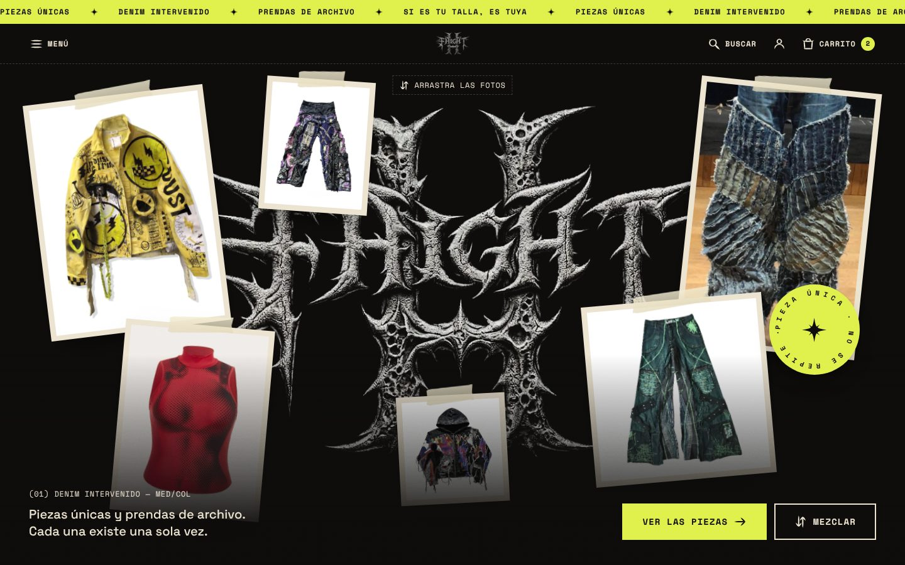
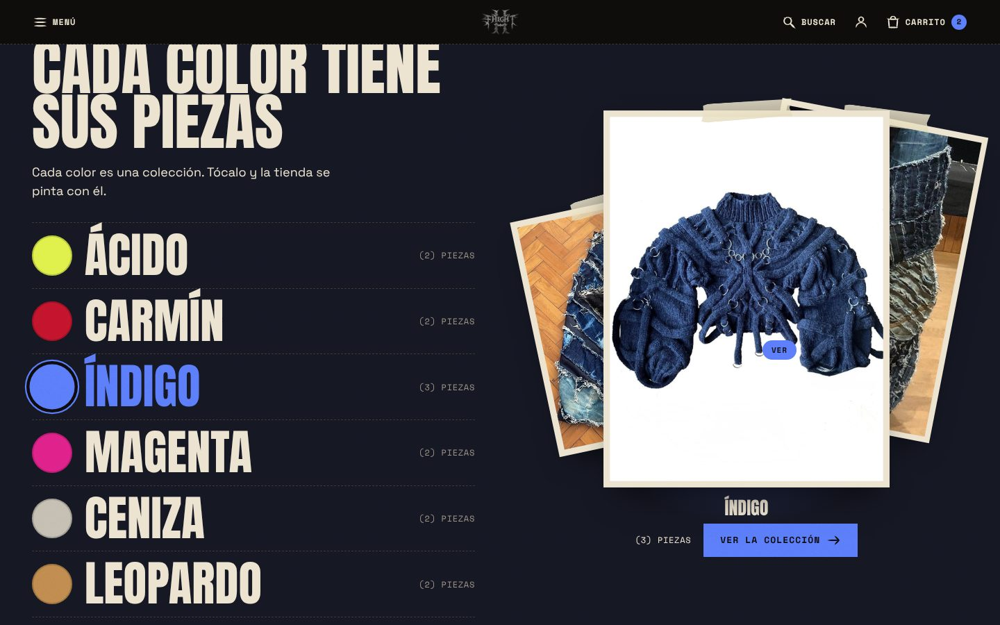
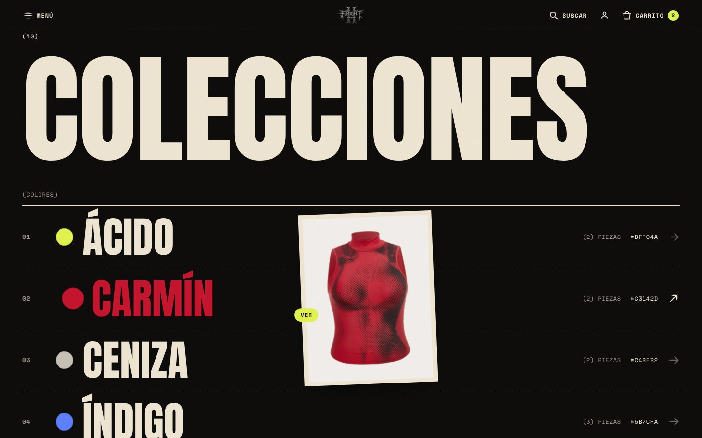
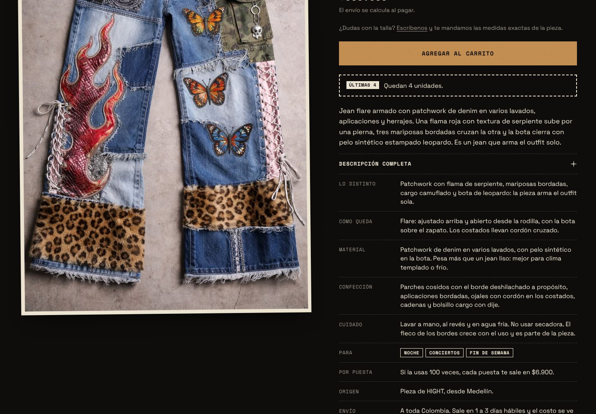
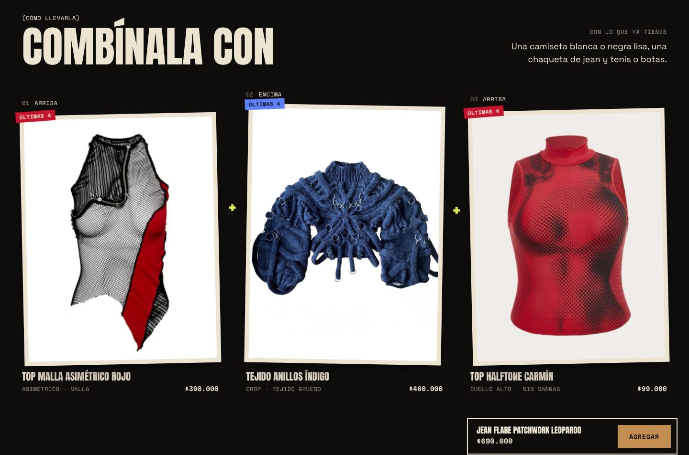

# Hight 2.0 — tema de Shopify

Tema Online Store 2.0 para **hight18.myshopify.com**. La versión 2.0 cambia la tienda por completo: colores,
tipografías y orden de las secciones salen de las prendas (denim intervenido, patchwork, tintes ácidos, malla) y
la página se volvió interactiva: las fotos se arrastran, las cintas de texto aceleran con el scroll, el visitante
elige el color de la tienda y cada pieza tiene su anatomía explicada punto por punto. Los colores salen de las
colecciones: cada color es una colección y, al abrirla, toda la tienda toma su color.



> Las capturas de `docs/preview/` se hicieron renderizando el Liquid del tema con las prendas reales de la tienda.
> La foto de la Chaqueta blood rose es un reemplazo de la vista previa: en la tienda se ve la foto real.

## Qué cambió

| | Hight 1.0 | Hight 2.0 |
| --- | --- | --- |
| Colores | Plata cepillada y aura (azul) | **Carbón** y **hueso** de base; **ácido** (Jean Dragón), **carmín** (Camiseta Célula), **índigo** (Jean Wide) y **leopardo** como acentos y fondos de sección |
| Tipografías | Archivo, IBM Plex Mono, Instrument Serif, Hight Espina | **Anton** (titulares gigantes), **Space Grotesk** (texto) y **Space Mono** (marquillas, precios, botones) |
| Motivos | Metal, cianotipo, halo | Fotos como copias impresas con cinta, costuras punteadas, grano de fotocopia y sellos que giran |
| Home | Hero, catálogo, spread, manifiesto | Hero collage → cinta → Lo nuevo → Elige tu color → video de campaña → Anatomía de una pieza → Archivo → Lookbook → Manifiesto |

El logo gótico se mantiene: es la marca. El design system original sigue en [`design-system/`](design-system/README.md) como referencia.

## Lo interactivo

- **Hero collage:** el logo al centro y las prendas como fotos pegadas con cinta. En computador se arrastran y se
  mueven con el cursor; en el teléfono flotan. El botón **MEZCLAR** las reparte de nuevo.
- **Cintas de texto:** corren de lado a lado y aceleran cuando haces scroll.
- **Lo nuevo:** fila con las últimas piezas que entraron. Se arrastra con el mouse, tiene flechas y barra de avance.
  Las tarjetas se inclinan con el cursor y dejan **AGREGAR** al carrito sin entrar a la ficha (o elegir talla, en la
  camiseta).
- **Elige tu color:** cada color es una colección (Radiactivo, Sangre Fría, Medianoche, Chicle, Asfalto y Fiera). Al tocarlo,
  **toda la tienda se pinta** con ese color, se ven sus piezas como fotos apiladas y un botón lleva a la colección. El
  navegador lo recuerda y se puede volver al color original.
- **Colecciones de color:** al entrar a una (desde el menú, el home o la fila de colores de cada colección), la
  tienda toma su color: botones, cintas, marquillas y el título gigante.
- **Anatomía de una pieza:** puntos numerados sobre el Jean Flare Patchwork Leopardo; cada uno abre su detalle.
- **Archivo:** lista con nombres gigantes; en computador la foto de cada pieza sigue al cursor.
- **Manifiesto:** el texto se enciende palabra por palabra con el scroll.
- **Menú a pantalla completa** con foto al pasar por cada enlace; los colores llevan su punto y tiñen el menú.
  También: **zoom** de fotos en la ficha, **barra para comprar** cuando el botón queda arriba (abajo en el teléfono,
  como tarjeta en el computador), selector de **columnas** en la
  tienda, etiqueta junto al cursor (VER, ARRASTRA) y transición suave entre páginas.

Todo respeta la opción de reducir movimiento del teléfono o del computador, y se puede apagar en
*Configuración del tema > Movimiento*.



## Colecciones y colores

| Colección | Qué entra | Color | Dirección |
| --- | --- | --- | --- |
| Lo nuevo | Todas las piezas, de la más nueva a la más vieja (fila del home) | — | `/collections/lo-nuevo` |
| Pantalones | Tipo de producto Jean, Pantalón o Short | — | `/collections/pantalones` |
| Tops | Tipo Top o Camiseta | — | `/collections/tops` |
| Buzos y tejidos | Tipo Buzo, Tejido o Chaqueta | — | `/collections/buzos-y-tejidos` |
| **Radiactivo** | Etiqueta `Color Ácido`: amarillo neón y verdes sobreteñidos | `#dff04a` | `/collections/acido` |
| **Sangre Fría** | Etiqueta `Color Carmín`: rojo carmín | `#c3142d` | `/collections/carmin` |
| **Medianoche** | Etiqueta `Color Índigo`: índigo y azul noche | `#5b7cfa` | `/collections/indigo` |
| **Chicle** | Etiqueta `Color Magenta`: rosa, fucsia y violeta | `#e0218a` | `/collections/magenta` |
| **Asfalto** | Etiqueta `Color Ceniza`: grises, hueso y carbón | `#c4beb2` | `/collections/ceniza` |
| **Fiera** | Etiqueta `Color Leopardo`: animal print y tonos tierra | `#c08a4e` | `/collections/leopardo` |

Cada color tiene nombre propio, descripción y título para buscadores. Al cambiarles el nombre se dejaron igual la
dirección y la etiqueta, así que los enlaces viejos siguen funcionando y no hubo que volver a etiquetar las prendas.

Son colecciones automáticas: una prenda nueva entra sola si tiene el tipo o la etiqueta. El color se cambia en
*Productos > Colecciones > (colección) > Metacampos > Color de la colección*; con ese campo lleno, la colección
aparece con su punto en el menú, en la fila de colores y en la lista de colecciones, y pinta la tienda al abrirla.
El menú principal queda así: Tienda, Pantalones, Tops, Buzos y tejidos, Colores (con los 6 colores adentro) y
Contacto.



## La ficha responde antes de que pregunten

Cada ficha contesta, sin preguntas a la vista, lo que alguien revisa antes de comprar. El bloque **Datos de la
pieza** va debajo de la descripción y la sección **Combínala con** debajo de la ficha.

| Lo que se pregunta | Dónde se contesta | De dónde sale |
| --- | --- | --- |
| ¿La necesito o solo la quiero? | LO DISTINTO: qué tiene que no tiene lo de tu clóset | `custom.distinto` |
| ¿Con qué la combino? | COMBÍNALA CON: tres prendas disponibles (arriba, encima, abajo) y *Con lo que ya tienes* | tipo y color de las prendas, o `custom.combina` |
| ¿Cómo queda al sentarme o moverme? | CÓMO QUEDA, y la talla con sus medidas | `custom.nota_corte`, `custom.talla`, `custom.medidas` |
| ¿Es cómoda? ¿Para qué clima? | MATERIAL | `custom.material` |
| ¿Está bien hecha? | CONFECCIÓN | `custom.confeccion` |
| ¿Cuánto dura? ¿Cómo se cuida? | CUIDADO (el párrafo "Cuidado:" de la descripción ya no se repite) | `custom.cuidado` |
| ¿Vale lo que cuesta? | POR PUESTA: el precio dividido entre 100 puestas | precio de la variante |
| ¿Cuándo me la pongo? | PARA: ocasiones | `custom.ocasiones` |
| ¿Quién la hizo? ¿La puedo devolver? | ORIGEN, ENVÍO y CAMBIOS, con enlace a las políticas | marca (`vendor`) o `custom.origen`, y ajustes del bloque |

Las filas sin dato no aparecen. *Combínala con* ordena las prendas disponibles: primero las del mismo color, luego
las de colores que van con todo (Asfalto y Medianoche) y después el resto. Cada puesto elige entre las tres mejores de su
grupo según la prenda, para que no todas las fichas sugieran lo mismo. Las piezas vendidas no se sugieren, tampoco
si alguien las dejó en `custom.combina`.

La descripción de cada prenda abre con un párrafo y guarda el resto en **Descripción completa**: detalles, corte,
material y clima, confección y cómo llevarla.





Las mismas respuestas están dibujadas, prenda por prenda, en los bocetos para Illustrator de
[`bocetos/`](bocetos/README.md): boceto plano de frente y espalda, detalles numerados y la ficha completa.

Los textos de las políticas de cambios y de envíos están en [`docs/politicas/`](docs/politicas/), listos para pegar
en *Configuración > Políticas*. Mientras no estén ahí, la ficha enlaza a las páginas **Envíos** y **Cambios y
devoluciones**.

## Fotos y videos de Higgsfield

El tema tiene tres lugares listos para el material de campaña (por ejemplo, el que generes en Higgsfield):

1. **Hero collage > Fondo:** un video en bucle detrás del logo y las fotos.
2. **Video de campaña:** sección a pantalla completa con titular y botón. Sin video no aparece en la tienda.
3. **Lookbook:** hasta 6 fotos pegadas como en un fanzine. Sin fotos no aparece en la tienda.

Sube el archivo en *Contenido > Archivos* o directamente en el campo de la sección, desde *Personalizar*.

## Configurar la tienda

1. **Color de cada prenda:** metacampo de producto `custom.acento` (tipo color). La ficha, la tarjeta y el botón
   de compra usan ese color. Sin metacampo se usa el acento del tema.
2. **Menús:** `main-menu` (se abre a pantalla completa; de 3 a 6 enlaces, con submenú para los colores) y `footer`.
3. **Color de cada colección:** metacampo de colección `custom.acento` (*Color de la colección*). Las colecciones
   con color se usan en *Elige tu color* (bloque **Color > Colección**), en el menú y en la fila de colores.
4. **Precio:** *Configuración > Tienda > Moneda > Cambiar formato*: `${{amount_no_decimals_with_comma_separator}}` → `$690.000`.
5. **Existencias:** cada prenda tiene 4 unidades y la camiseta 3 por talla. Desde 5 unidades hacia abajo, la tarjeta
   dice **ÚLTIMAS N** y la ficha *Quedan N unidades*; la última unidad dice **ÚLTIMA**. **PIEZA ÚNICA** y el sello que
   gira salen solo en una prenda con la etiqueta `Pieza única`, una sola variante y 1 unidad. El límite se cambia en
   *Configuración del tema > Productos*.
6. **Envío gratis:** el aviso del carrito está apagado (0). Actívalo en *Configuración del tema > Carrito* solo si lo ofreces.
7. **Talla y medidas de cada pieza:** metacampos `custom.talla` (*Talla de la pieza*: S, M, 30, Única) y
   `custom.medidas` (*Medidas de la pieza*, una por línea). La talla va en una marquilla sobre la foto de la
   tarjeta y, con las medidas, en la ficha. Se llenan en *Productos > (prenda) > Metacampos*.
8. **Datos de cada pieza:** `custom.distinto`, `custom.nota_corte` (*Cómo queda*), `custom.material`,
   `custom.confeccion`, `custom.cuidado`, `custom.ocasiones` (lista) y, si hace falta, `custom.origen` y
   `custom.combina` (hasta tres productos para *Combínala con*). Las 26 prendas ya los tienen.
9. **Metacampos opcionales:** `custom.corte_material` (*Corte y material*, en la tarjeta), `custom.ficha`
   (ficha técnica) y `custom.guia_tallas` (`camiseta`, `hoodie` o `pantalon`).

## Publicar con Shopify CLI

```bash
npm install -g @shopify/cli@4.9.0
git clone https://github.com/yhdc86dgnb-afk/HIGHT.git && cd HIGHT
git checkout claude/shopify-hight-design-system-1nh69f

shopify theme check                                      # validar
shopify theme dev --store hight18.myshopify.com          # vista previa con los datos reales
shopify theme push --store hight18.myshopify.com --unpublished --theme "Hight 2.0"
```

Con el entorno de `shopify.theme.toml`: `shopify theme dev -e hight` y `shopify theme push -e hight --unpublished`.
Cuando el tema esté revisado, se publica desde **Tienda online > Temas > Hight 2.0 > Publicar**.

## Estructura

```
assets/          hight.css, hight.js, fuentes (Anton, Space Grotesk, Space Mono), logos y grano
config/          settings_schema.json (acento, 5 esquemas, movimiento) y settings_data.json
layout/          theme.liquid y password.liquid
locales/         es.default.json
sections/        hero-collage, marquee, featured-collection, color-story, hotspots, index-list,
                 manifesto, video-campaign, editorial-spread (lookbook), titular, header, footer…
snippets/        product-card, sticker, product-gallery, density-toggle, price, icon…
templates/       plantillas JSON + gift_card.liquid
design-system/   design system HIGHT original (referencia)
docs/preview/    capturas de la vista previa
docs/politicas/  políticas de envío y de cambios para pegar en Shopify
bocetos/         fichas técnicas para Illustrator (SVG y PDF) y su generador
```

`shopify theme check` pasa sin observaciones y el workflow `.github/workflows/theme-check.yml` lo corre en cada push.

Las fuentes Anton, Space Grotesk y Space Mono tienen licencia SIL Open Font License 1.1 (vía Fontsource).
