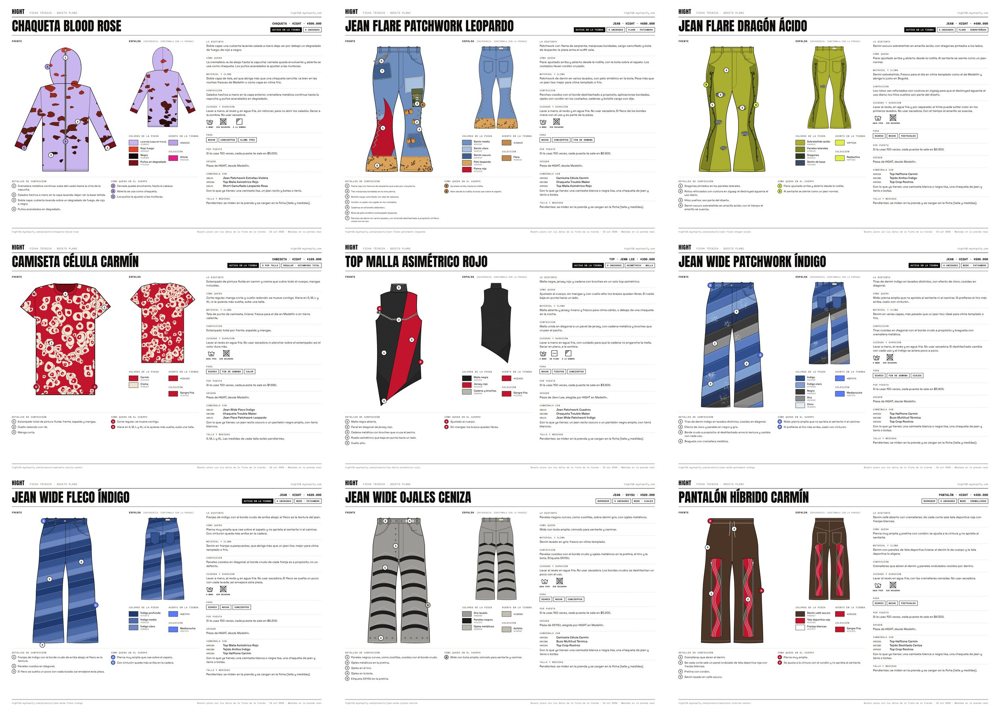

# Bocetos para Illustrator

Una ficha técnica por prenda (26 en total), en A3 horizontal, con el boceto plano de frente y espalda y las
respuestas que cada ficha de la tienda da sin preguntas a la vista.



## Archivos

| Archivo | Para qué |
| --- | --- |
| `01-…svg` a `26-…svg` | Una hoja por prenda, en vector. Se abren y se editan en Illustrator. |
| `hight-bocetos.pdf` | Las 26 hojas en un solo PDF, para ver, imprimir o abrir en Illustrator. |
| `vista-previa-1.jpg` a `-3.jpg` | Hojas de contacto para mirar todas de un vistazo. |
| `generador/` | El programa que arma las hojas a partir de los datos de la tienda. |

Los números siguen el orden en que las prendas entraron a la tienda.

## Qué tiene cada hoja

- **Encabezado:** nombre, tipo, marca, precio, si está activa o en borrador, las unidades (4 por prenda; 3 por talla
  en la camiseta) y el corte. Si alguna vez una prenda es pieza única, el chip dice PIEZA ÚNICA.
- **Frente y espalda:** silueta plana con costuras, pespuntes, herrajes y los detalles de la prenda (parches,
  rotos, pintura, cremalleras, cadenas, ojales…). Cuando la tienda no describe la espalda, dice *Referencia:
  confírmala con la prenda*.
- **Llamadas numeradas (1, 2, 3…):** detalles de confección, explicados abajo en *Detalles de confección*.
- **Llamadas con letra (A, B, C):** cómo queda en el cuerpo, explicado en *Cómo queda en el cuerpo*.
- **Colores de la pieza**, el color de acento que usa la tienda y la colección de color donde aparece (Radiactivo,
  Sangre Fría, Medianoche, Chicle, Asfalto o Fiera).
- **Columna derecha:** lo distinto, cómo queda, material y clima, confección, cuidado (con símbolos de lavado),
  ocasiones, costo por puesta, origen, con qué combinarla y talla y medidas.

Cada respuesta sale de los mismos datos que se ven en la ficha de la tienda, así que si una cambia allá, conviene
volver a generar la hoja.

## Abrir en Illustrator

1. Instala las tres tipografías de la marca desde Google Fonts: **Anton**, **Space Grotesk** y **Space Mono**.
   Sin ellas, Illustrator las reemplaza por otras y los textos cambian de ancho.
2. Abre el `.svg` de la prenda (*Archivo > Abrir*). Todo queda en vector: siluetas, rellenos y textos editables.
3. En el panel *Capas*, los grupos llevan nombre: `…-encabezado`, `…-boceto` (con `…-frente` y `…-espalda`, y
   dentro `relleno`, `estampado`, `costuras`, `piezas`, `detalles`, `silueta`), `…-llamadas`, `…-colores`,
   `…-leyenda`, `…-ficha` y `…-pie`. Para trabajar solo el dibujo, oculta `…-ficha` y `…-leyenda`.
4. El estampado está recortado con una máscara a la forma de la prenda. Para editarlo, entra al grupo
   `estampado` o usa *Objeto > Máscara de recorte > Soltar*.

El PDF también abre en Illustrator, una página a la vez. Para editar, el SVG queda más ordenado.

## Medidas

Las tallas y medidas reales todavía no están cargadas en la tienda, así que las hojas no inventan centímetros:
dicen *Pendientes*. Cuando se carguen los metacampos `custom.talla` y `custom.medidas`, se vuelven a generar.

## Volver a generar

Requiere Node con Playwright (Chromium). Desde la raíz del repo:

```bash
node bocetos/generador/build.js bocetos/generador/data.json bocetos /tmp/bocetos-png
```

`generador/data.json` es una copia de los datos de la tienda del 19 de octubre de 2026. Los dibujos de cada prenda
están en `generador/specs.js`. Las fuentes de `generador/fonts/` son Space Grotesk 400, 500 y 700 en versión fija
(SIL Open Font License 1.1), para que el PDF guarde el texto como texto.
