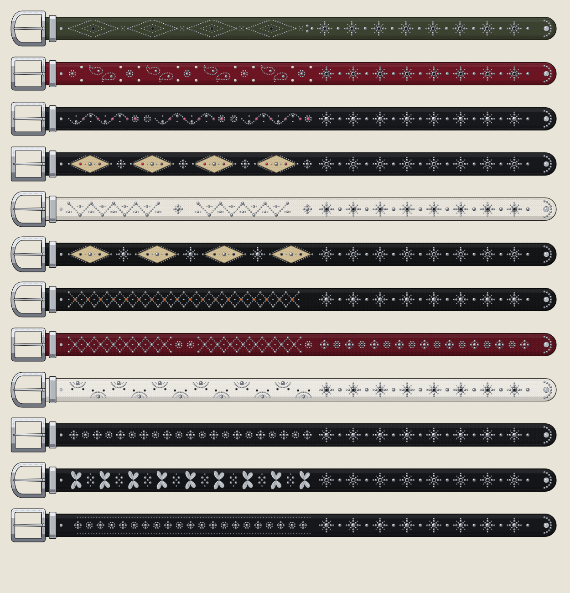

# Correas de tachas



Las 12 correas de la foto, dibujadas en vector como en Illustrator: el cuero con su canto pintado, su pespunte y su
textura (lisa, granulada o de víbora), las tachas en tres tonos de plata con contorno negro, las piedras en su engaste
(negras, rosadas, rojas y naranjas), las incrustaciones de cuero beige, las mariposas de plata y la hebilla con su
lengüeta y su presilla. Están acostadas, con la hebilla a la izquierda, y en el mismo orden que en la foto.

| Correa | Cuero | Dibujo, de la hebilla a la mitad | Cerca de la punta |
| --- | --- | --- | --- |
| 01 | Verde oliva, liso | Rombos de tachas con piedra negra, unidos por equis | Flores grandes con hoyo y domos |
| 02 | Vino, granulado | Cachemires, pares de puntos blancos y florcitas | Flores grandes con hoyo |
| 03 | Negro, granulado | Cadenas en ese con piedras rosadas y flores con piedra | Flores grandes |
| 04 | Negro, granulado | Rombos de cuero beige con piedras rojas y cruces de domos | Flores grandes con hoyo |
| 05 | Blanco, granulado | Zigzag de tachas con domos en las puntas | Flores grandes con hoyo |
| 06 | Negro, víbora | Rombos de cuero beige de víbora con piedras negras | Flores grandes con hoyo |
| 07 | Negro, víbora | Equis de tachas con piedras naranjas | Flores grandes |
| 08 | Vino, víbora | Equis de tachas y florcitas | Cruces de domos y florcitas con hoyo |
| 09 | Blanco, granulado | Medias lunas con domo grande y piedras negras | Flores grandes con hoyo |
| 10 | Negro, víbora | Cruces de domos y florcitas | Flores grandes |
| 11 | Negro, granulado | Mariposas de plata y cuadros de domos | Flores grandes con hoyo |
| 12 | Negro, liso | Cruces de domos, florcitas y tachas por las orillas | Flores grandes |

Cada `correa-XX.svg` se abre y se edita en Illustrator. Las tachas son símbolos: si cambias uno (por ejemplo, el
domo), cambian todos.

En la tienda van en la sección *Correas* del inicio, que reemplazó a la cinta de texto: dos filas que corren en
sentidos contrarios.

## Cómo se arman

```bash
python3 correas.py <carpeta del tema>
```

Deja `assets/correa-01.svg` a `correa-12.svg` en el tema y una copia de cada una en esta carpeta. Los colores, las
texturas, la hebilla y la lista de motivos de cada correa están en `BELTS`, dentro de `correas.py`.
