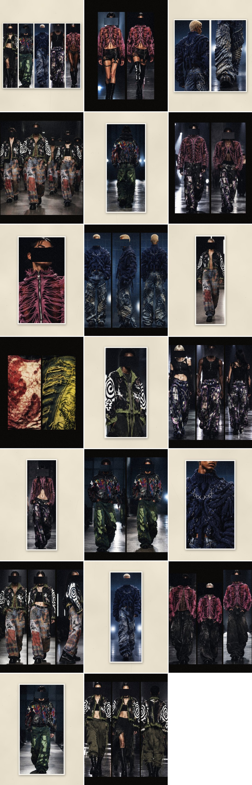

# Desfile



Veinte posts del Drop 01 en la pasarela: solo la ropa, sin una sola letra en las fotos. Las salidas tienen modelos de
rasgos, estaturas y orígenes distintos, con la cara tapada por un pedazo del fondo, y cada post trae música propia de
fondo en tres géneros: neo-psicodelia, rock psicodélico y pop psicodélico. El tono es serio, elegante y rebelde.

La muestra interactiva (el perfil con la cuadrícula y cada post abierto con su descripción y su música) está en
`muestra.html`; publicada, se ve en el enlace que va en el informe.

## Lo que hay

- **20 posts** en 1080 × 1350 (`posts/`). Alternan para que la cuadrícula del perfil quede en tablero, como en la campaña
  sin texto: los impares son de noche, con varias salidas seguidas sobre negro, como se ven en la pasarela; los pares
  son de papel, con una sola salida o un detalle como copia de archivo con su margen. El último reúne una salida de
  cada conjunto, como el final de un desfile.
- **20 videos** (`videos/`), uno por post: la misma imagen con un acercamiento lento que va y vuelve, su pedazo de música
  y la luz que late con cada compás. Duran compases enteros, cerca de 12 segundos.
- **3 pistas propias** (`musica/`), de unos 37 segundos cada una, hechas aquí con senos, ruido y cuerdas pulsadas, sin
  muestras ni canciones de otros. Las tres terminan con el sonido de la marca: las tres campanas en re mayor.
- **Las descripciones** (`textos.md`): tres líneas por post con la voz de Hight, los productos que se etiquetan, la
  música de cada uno y el calendario.

## Las referencias

| Referencia | Qué se tomó |
| --- | --- |
| El archivo de Balenciaga (`balenciaga_files`) | Las salidas una al lado de la otra como trípticos de pasarela, el look solo, el retrato y el detalle, y las copias de archivo sobre papel |
| Los desfiles de Undergold | La pasarela de concreto con el público en la sombra, la luz fría de los ventanales, una salida por toma y solo la ropa en la foto |
| El casting de los dos | Rasgos, estaturas y orígenes distintos; pelo mojado, cejas decoloradas, cabezas rapadas, gafas oscuras |

Las fotos de referencia muestran personas reales de otras marcas. No se usaron sus caras ni sus fotos para generar
nada: solo se tomó el tipo de casting, la pose, la luz y el lugar.

## Cómo se hicieron las fotos

Con la IA de Canva, a partir de las fotos reales de las prendas que ya están en el repo (los recortes de
`../instagram/imagenes/`). Canva entrega cada pedido como una hoja con varias salidas del mismo conjunto
(`fuentes/pasarela-*.jpg`), y `fuentes/tomas.json` dice dónde está cada salida. `posts.py` las recorta, les pone a todas
el mismo color de archivo (los negros apenas levantados, el color un poco lavado y grano de película) y arma cada post.
No se pasan por procesos que tapen la ropa.

Se dejaron fuera las salidas en las que la IA cambió la ropa o puso letras:

- **La Chaqueta Smiley Ácido**: sus letras pintadas salen deformadas, así que no entra en el desfile.
- **Ropa que la tienda no tiene**: el Jean Wide Patchwork Índigo convertido en un conjunto de chaqueta y jean, el Jean
  Flare Destroyed Verde convertido en falda larga, y trajes y abrigos grises que salieron del encuadre de referencia
  (`encuadre.py`), con caras sin rasgos.
- **El Top Malla Asimétrico Rojo**: el filtro de seguridad de Canva frenó su foto, por ser una malla transparente.

Algunas salidas llevan piezas de fondo que no son de Hight: pantalones cargo oscuros o verde oliva, faldas negras y
botas. En las descripciones solo se nombran y se etiquetan las prendas de la tienda.

## Las caras tapadas

Como en las referencias de la campaña, cada cara va tapada con un rectángulo hecho de un pedazo del fondo de la misma
foto: se toma al lado de la cabeza, a la misma altura, y se pega con bordes duros, de las cejas a debajo de la boca. La
barbilla queda a la vista. Sobre los fondos de noche la barra casi se pierde y la cabeza queda flotando; donde el fondo
es más claro, se nota el rectángulo. Solo cambian las caras: la ropa queda igual.

- `caras.py` busca las caras con el detector de caras de MediaPipe y deja `fuentes/caras.json`: 31 caras en 26 salidas,
  revisadas a ojo. No se tapan las caras de los estampados, como las del Buzo Multitud Térmica.
- No llevan barra las espaldas (la tercera salida de los posts 01, 09 y 13, el 16 y la cabeza que se gira de espaldas en
  el 18), el detalle del Tejido Anillos Índigo (06), que ya corta la cara en la nariz, ni los detalles de la ropa (11 y
  el jean del 18).
- `posts.py` pone las barras antes del color de archivo, así llevan el mismo grano que el resto de la foto. Escoge el
  pedazo de fondo más liso que tenga el tono de alrededor de la cabeza; en las caras grandes, un pedazo más angosto se
  repite en espejo.

## Lo que hay que saber de las fotos

- **Son imágenes hechas con IA.** Las modelos no existen y cada prenda es una versión de la IA a partir de la foto real:
  los detalles pueden cambiar un poco (por ejemplo, la capucha de la Chaqueta Blood Rose casi no se ve). Las fichas de
  la tienda muestran las prendas reales, que es lo que compra la gente.
- **En Instagram se etiquetan como hechas con IA.** Al publicar cada post, en la configuración avanzada, se activa
  «Etiquetar este contenido como hecho con IA». Instagram baja el alcance del contenido con personas hechas con IA que
  no lleva la etiqueta. El primer post también lo dice en su descripción.
- **La resolución**: cada salida sale de una hoja de varias, así que está agrandada entre 1,5 y 2 veces. Por eso los
  posts las muestran en secuencia o como copias con margen, y no una sola salida a todo el cuadro. En el teléfono se ven
  nítidas; en una pantalla grande se nota que son copias blandas.

## Cómo publicarlo

- **Con música propia:** sube el video del post (`videos/NN.mp4`). Instagram lo publica como reel en 4:5 y lo deja en la
  cuadrícula; como portada elige el primer cuadro, que es el post. Es la forma de que suene nuestra música, que
  Instagram no silencia.
- **Como foto:** sube `posts/NN.jpg`. Las fotos solo aceptan música de la biblioteca de Instagram; si la cuenta es de
  empresa, la biblioteca solo trae música libre de derechos, así que busca allí neo-psicodelia, rock o pop psicodélico,
  o súbela sin música.
- **Etiquetas de producto:** cada post lleva las de `textos.md`. Hace falta el canal de Facebook e Instagram de Shopify
  conectado.
- **Pie de foto:** el de `textos.md`. Si prefieres que el desfile vaya sin nada escrito, como la campaña sin texto, los
  posts funcionan igual sin pie de foto; deja al menos la etiqueta de IA.
- **Orden:** del 01 al 20, uno por día, para que el tablero salga como en la vista previa.

## Archivos

| Archivo | Qué es |
| --- | --- |
| `posts/01.jpg` a `20.jpg` | Los 20 posts en 1080 × 1350, en orden de publicación |
| `videos/01.mp4` a `20.mp4` | Cada post en video, con su pedazo de música |
| `musica/neo-psicodelia.mp3`, `rock-psicodelico.mp3`, `pop-psicodelico.mp3` | Las tres pistas enteras |
| `textos.md` | Las descripciones, las etiquetas, la música de cada post y el calendario |
| `muestra.html` | La muestra del perfil: la cuadrícula y cada post abierto con su descripción y su música |
| `vista-previa.jpg` | La cuadrícula del perfil con los 20 posts, recortados a 3:4 como los muestra Instagram |
| `fuentes/pasarela-*.jpg` | Las hojas de salidas que entregó Canva, una por conjunto |
| `fuentes/tomas.json` | Dónde está cada salida dentro de su hoja |
| `fuentes/caras.json` | Dónde está cada cara: su caja y los puntos de los ojos, la nariz, la boca y las orejas |
| `fuentes/encuadre-pasarela.png` | El encuadre de referencia que se probó para pedir una sola salida por foto |
| `posts.py` | Arma los 20 posts, con las caras tapadas, y la vista previa |
| `caras.py` | Busca las caras de las salidas y arma `fuentes/caras.json` |
| `musica.py` | Arma las tres pistas (usa los instrumentos de `../reels/sonido.py`) |
| `videos.py` | Arma los 20 videos con su música |
| `muestra.py` y `muestra-plantilla.html` | Arman `muestra.html` con las descripciones de `textos.md` |
| `encuadre.py` | Dibuja el encuadre de referencia |

## Volver a generarlos

Requiere Python 3 con NumPy, Pillow y OpenCV, y ffmpeg. Desde la raíz del repo:

```bash
python3 bocetos/desfile/posts.py      # los 20 posts y la vista previa (o algunos: posts.py 3 7)
python3 bocetos/desfile/musica.py     # las tres pistas (o una: musica.py rock-psicodelico)
python3 bocetos/desfile/videos.py     # los 20 videos (o algunos: videos.py 1 20)
python3 bocetos/desfile/muestra.py    # la muestra del perfil
```

Los posts tardan unos segundos; la música, menos de un minuto; los videos, unos tres minutos en total.

`fuentes/caras.json` ya está en el repo. Solo hay que volver a sacarlo si cambian las fotos, con `caras.py`, que
necesita OpenCV 4.8 o más nuevo y los modelos de caras de MediaPipe. Vienen en el paquete face-detection-tflite de PyPI
y no se guardan en el repo:

```bash
pip download face-detection-tflite==0.6.0 --no-deps -d /tmp/fd
unzip -j /tmp/fd/face_detection_tflite-0.6.0-py3-none-any.whl 'fdlite/data/face_detection_*_range.tflite' -d /tmp/fd
python3 bocetos/desfile/caras.py /tmp/fd     # unos dos minutos; después, posts.py
```

Si cambian las fotos, hay que revisar a ojo las caras que encuentra: las listas `SIN_CARA` y `GRUPOS` de `caras.py`
dicen qué salidas no llevan barra y cuáles son de grupo.

## Lo que falta

- **Las prendas que no salen**: el desfile muestra 10 de las 20 prendas. Faltan el Top Halftone Carmín, el Jean Flare
  Patchwork Leopardo, el Buzo Destroyed Ceniza, el Tejido Deshilado Ceniza, el Jean Flare Costura Neón, el Jean Wide
  Patchwork Índigo, el Short Camuflado Leopardo Rosa, el Top Crop Rostros, el Top Malla Asimétrico Rojo y la Chaqueta
  Smiley Ácido. El cupo diario de imágenes de IA de Canva se acabó después de cuatro hojas; cuando vuelva, se piden las
  que faltan con las mismas palabras y se suman.
- **Fotos reales**: para vender, lo mejor sigue siendo un desfile o una sesión real con estas prendas. Estas fotos
  sirven para la campaña mientras tanto.
