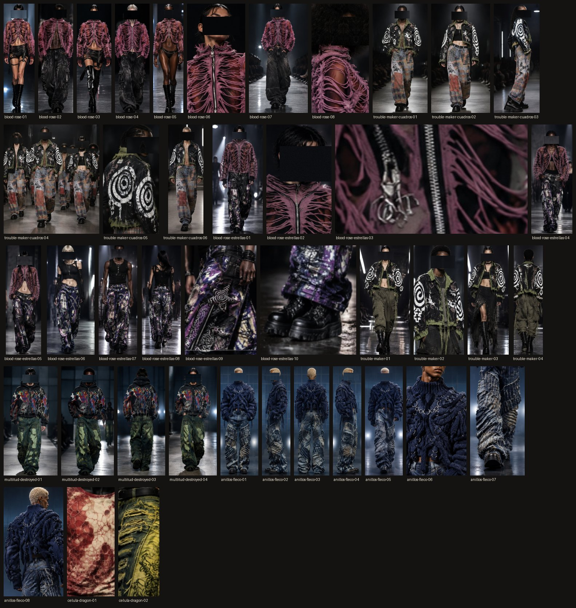

# Fotos originales del desfile

Las fotos del desfile tal como salieron de la IA de Canva, con las caras tapadas con la misma barra de los posts: un
pedazo del fondo de la misma foto, de las cejas a debajo de la boca. Fuera de la barra no cambia nada: sin color, sin
agrandar y sin el diseño de los posts. Las espaldas, la cabeza que se gira de espaldas, el detalle que corta la cara en la
nariz (`anillos-fleco-06`) y los detalles de la ropa no llevan barra.

- `salidas/`: las 42 salidas, cada una recortada de su hoja sin la línea que la separa de las otras. Van en JPG de calidad
  95, para no perder nada más de lo que ya trae el JPG de Canva.
- Las 7 hojas completas, como las entregó Canva y sin barras: en el repo están en `../fuentes/pasarela-*.jpg`.

**Lo que hay que saber**

- **El tamaño:** Canva entrega varias salidas en una hoja de 1080 × 1350, así que cada salida mide de 157 a 539 px de ancho
  y de 161 a 718 px de alto. En el teléfono se ven bien; para imprimir o una pantalla grande se quedan cortas.
- **Son imágenes hechas con IA:** las modelos no existen y cada prenda es una versión de la IA a partir de la foto real.
  Al publicarlas en Instagram, activa «Etiquetar este contenido como hecho con IA».
- **Lo que no es de Hight:** algunas salidas llevan piezas de fondo que no son de la tienda, como pantalones cargo, faldas
  y botas. Solo se nombran y se etiquetan las prendas de la tienda.

## Qué muestra cada una

| Archivo | Qué muestra | En el post |
| --- | --- | --- |
| `blood-rose-01` a `-05` y `-07` | Chaqueta Blood Rose, en la pasarela | 01 y 03: 19 · 02, 04 y 07: 03 · 05: 20 |
| `blood-rose-06` | Chaqueta Blood Rose, de cerca | 14 |
| `blood-rose-08` | Chaqueta Blood Rose, retrato | — |
| `blood-rose-estrellas-01`, `-04` y `-05` | Chaqueta Blood Rose con el Jean Patchwork Estrellas Violeta | 01 y 04: 15 · 05: 08 |
| `blood-rose-estrellas-02` | Chaqueta Blood Rose, retrato | — |
| `blood-rose-estrellas-03` | Chaqueta Blood Rose, detalle de la cremallera (muy pequeña: 284 × 161 px) | — |
| `blood-rose-estrellas-06` a `-08` | Jean Patchwork Estrellas Violeta; la 08, de espalda | 09 (la 07, también el 20) |
| `blood-rose-estrellas-09` y `-10` | Jean Patchwork Estrellas Violeta, detalles | — |
| `trouble-maker-01` y `-03` | Chaqueta Trouble Maker | 01 (la 03, también el 20) |
| `trouble-maker-02` | Chaqueta Trouble Maker, de cerca | 10 |
| `trouble-maker-04` | Chaqueta Trouble Maker, de espalda | 01 |
| `trouble-maker-cuadros-01` a `-03` y `-06` | Chaqueta Trouble Maker con el Jean Patchwork Cuadros | 05 (la 06, el 12) |
| `trouble-maker-cuadros-04` | La misma, en grupo | 17 |
| `trouble-maker-cuadros-05` | Chaqueta Trouble Maker, de espalda y de cerca | — |
| `multitud-destroyed-01`, `-02` y `-04` | Buzo Multitud Térmica con el Jean Flare Destroyed Verde | 01: 02 y 20 · 02 y 04: 07 |
| `multitud-destroyed-03` | Buzo Multitud Térmica, de espalda | 16 |
| `anillos-fleco-01` a `-03` | Tejido Anillos Índigo con el Jean Wide Fleco Índigo: de frente, de lado y de espalda | 13 |
| `anillos-fleco-04` | La misma, de lado | — |
| `anillos-fleco-05` | La misma, caminando | 04 y 20 |
| `anillos-fleco-06` | Tejido Anillos Índigo, de cerca | 06 |
| `anillos-fleco-07` | Jean Wide Fleco Índigo, de cerca | 18 |
| `anillos-fleco-08` | Tejido Anillos Índigo, de espalda | 18 |
| `celula-dragon-01` | Camiseta Célula Carmín, de cerca | 11 |
| `celula-dragon-02` | Jean Flare Dragón Ácido, de cerca | 11 |

Las de «—» no salieron en ningún post. Para volver a sacarlas, desde la raíz del repo:
`python3 bocetos/desfile/originales.py`.
