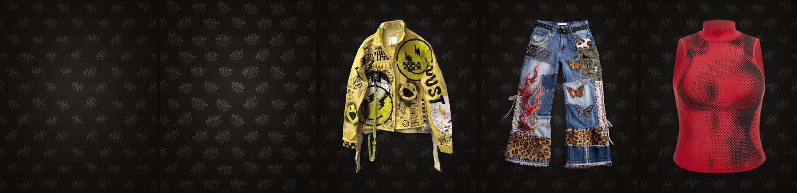
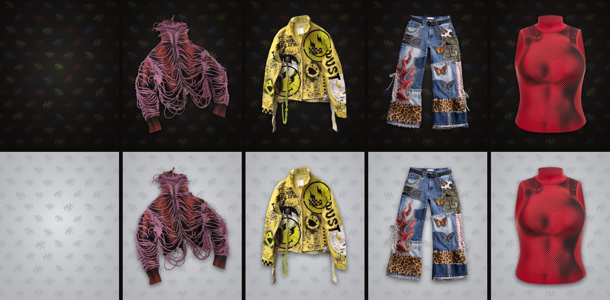
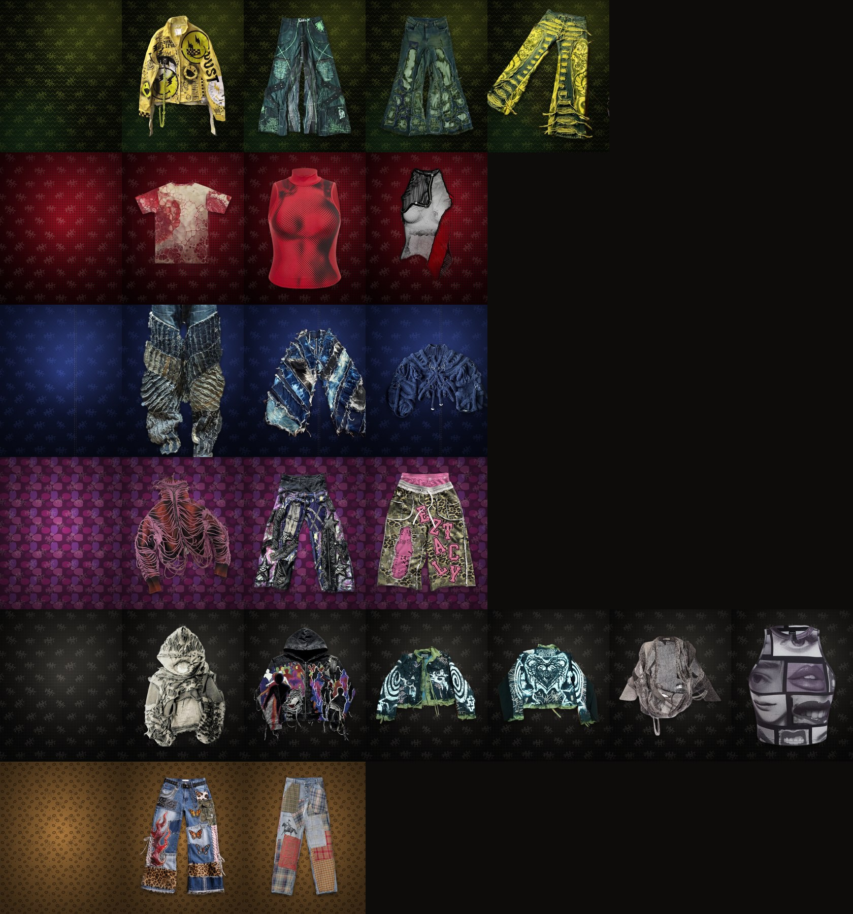

# Fondo de logos



El logo de Hight en plateado sobre negro, repetido como un estampado de perchas: filas corridas, cada logo un poco
girado y con aire entre uno y otro.

## Para poner detrás de las prendas

Fondo de estudio para las fotos de producto. Los logos van apagados, casi invisibles en las orillas, y en el centro cae
una luz suave, así que la prenda es lo primero que se ve. Sigue la receta de foto de producto del manual de marca
(`design-system/secciones/03-fotografia.md`): vertical 4:5, 2.000 px por el lado largo, la prenda centrada y ocupando
el 80 % del alto, sin sombras duras y el mismo fondo para toda la colección.

| Archivo | Tamaño | Qué es |
| --- | --- | --- |
| `prenda-plata.png` | 1600 × 2000 | El fondo solo, con el logo plateado tal cual. |
| `prenda-plata-contorno.png` | 1600 × 2000 | El fondo solo, con el logo en contorno plateado. |
| `prendas/<prenda>.jpg` | 1600 × 2000 | Las 20 prendas del Drop 01, cada una sobre el fondo plateado, con una sombra suave, y la espalda de la Chaqueta Trouble Maker (`chaqueta-trouble-maker-espalda.jpg`). |
| `prendas.jpg` | | Las 21 juntas, para verlas de un vistazo. |

Las prendas salen de copias recortadas de las fotos originales (`../instagram/imagenes/`); las fotos originales no se
editan. Las que la foto original corta por un lado (el Jean Wide Patchwork Índigo, el Tejido Anillos Índigo y el Jean
Flare Dragón Ácido) van con ese lado contra el borde, para que el corte se vea a propósito; el Jean Wide Fleco Índigo,
que la foto corta arriba y abajo, va de alto completo.

Son las fotos de la tienda: cada ficha tiene solo su foto sobre el fondo, con el texto alternativo «*Prenda*, sobre el
fondo de Hight», y la Chaqueta Trouble Maker tiene además su espalda. Las fotos originales se quitaron de las fichas y
siguen guardadas en Contenido > Archivos de Shopify. La Lupa del inicio toma la segunda foto de la ficha como espalda,
así que solo la chaqueta tiene espalda; los puntos de la Anatomía y de la Lupa del Jean Flare Patchwork Leopardo están
medidos sobre su foto con el fondo.

Para una foto nueva, fotografía la prenda sobre un fondo liso, recórtala y ponla encima de `prenda-plata.png` con el
mismo tamaño y margen que las demás.

## Fondos alternativos



El mismo estampado, con los logos en el mismo lugar, en otros colores:

- **Colecciones:** cada logo va en el color de una de las seis colecciones de la tienda (Radiactivo, Sangre Fría,
  Medianoche, Chicle, Asfalto y Fiera), como metal teñido de ese color, sobre el mismo negro carbón. Los seis colores
  bajan en diagonal, en el orden en que rota la tienda.
- **Colores contrarios:** el logo en tinta sobre plata, al revés del original. Detrás de las prendas la plata se
  aclara hacia el centro, como la luz del estudio, y la prenda deja una sombra suave.

| Archivo | Tamaño | Qué es |
| --- | --- | --- |
| `prenda-colecciones.png`, `prenda-tinta.png` | 1600 × 2000 | El fondo solo, para poner detrás de las prendas. |
| `prendas-colecciones.jpg`, `prendas-tinta.jpg` | | Las 21 fotos de las prendas juntas sobre cada fondo, para compararlas con `prendas.jpg`. |
| `cuadro-colecciones.png`, `cuadro-tinta.png` | 2400 × 2400 | Para repetir, como el cuadro plateado. |
| `historia-colecciones.png`, `historia-tinta.png` | 1080 × 1920 | Del tamaño de una historia o un fondo de teléfono. |

Las fichas de la tienda siguen con el fondo plateado. Para tener cada prenda sobre uno de estos fondos, en
`prendas-colecciones/` o `prendas-tinta/`, se corre `python3 bocetos/fondos/prendas.py colecciones` (o `tinta`).

## Un fondo para cada colección



Los mismos logos, en el mismo lugar, sobre la textura de cada colección de color, la misma que dibuja la tienda cuando
le toca el turno: el zigzag de Radiactivo, el semitono de Sangre Fría, el denim de Medianoche, las manchas de Chicle, la
malla de Asfalto y el leopardo de Fiera. El logo va en el color de la colección; en Sangre Fría y Chicle va en hueso,
como el texto de la tienda sobre esos colores, y en Fiera en el café oscuro del leopardo, para que no se pierda. En
Chicle y Fiera la textura va más suave, porque sus manchas compiten con la prenda.

| Archivo | Tamaño | Qué es |
| --- | --- | --- |
| `por-coleccion/prenda-<colección>.jpg` | 1600 × 2000 | Para poner detrás de las prendas, con la receta del fondo plateado: la textura apagada en las orillas, una luz suave en el centro y los logos apagados. |
| `por-coleccion/historia-<colección>.jpg` | 1080 × 1920 | La textura y los logos enteros, del tamaño de una historia. |
| `por-coleccion/cuadro-<colección>.png` | 2400 × 2400 | El color de base de la textura con los logos. Empalma por los cuatro lados. |
| `por-coleccion/prendas.jpg` | | Las prendas publicadas de cada colección sobre su fondo, una fila por colección. |
| `por-coleccion/coleccion-<colección>.jpg` | 1600 × 2000 | La imagen de la colección en la tienda: su prenda de una por color sobre su fondo. |

Las colecciones van por su nombre: `radiactivo`, `sangre-fria`, `medianoche`, `chicle`, `asfalto` y `fiera`. Las fichas
de la tienda siguen con el fondo plateado; `python3 bocetos/fondos/por_coleccion.py prendas` deja también cada prenda
sobre el fondo de su colección, en `por-coleccion/prendas/`.

## Qué fondo va dónde

| Dónde | Fondo | Por qué |
| --- | --- | --- |
| Las fotos de las prendas: ficha, tarjetas, Lo nuevo y posts | Plateado (`prendas/`) | Uno solo para toda la colección: la prenda es lo primero que se ve y el fondo combina con el color que tenga la tienda en cada turno. |
| La imagen de cada colección de color: la página de colecciones y la vista del menú | El de su colección | Ahí la protagonista es la colección. Va con su prenda de una por color: Chaqueta Smiley Ácido, Top Halftone Carmín, Tejido Anillos Índigo, Jean Patchwork Estrellas Violeta, Chaqueta Trouble Maker y Jean Flare Patchwork Leopardo. |
| Piezas que muestran las seis colecciones juntas | Con las colecciones | Lleva los seis colores sin que ninguno mande. |
| Impresos sobre papel claro | En colores contrarios | Tinta sobre plata se lee sobre un fondo claro. |

Así está en la tienda desde el 27 de octubre de 2026: las fichas con el plateado y cada colección de color con su
imagen sobre su propio fondo.

## Para repetir

| Archivo | Tamaño | Qué es |
| --- | --- | --- |
| `cuadro-plata.png` | 2400 × 2400 | El logo plateado tal cual, con su brillo de metal. |
| `cuadro-plata-contorno.png` | 2400 × 2400 | El logo en contorno plateado, más liviano, como las líneas de las perchas. |
| `historia-plata.png`, `historia-plata-contorno.png` | 1080 × 1920 | Las mismas dos, del tamaño de una historia o un fondo de teléfono. |

El cuadro empalma por los cuatro lados, así que se puede repetir sin que se note la unión: sirve para la web, papel de
seda o bolsas, e impreso a 300 puntos por pulgada mide 20 × 20 cm. El fondo es el negro carbón de la marca.

## Volver a generarlos

Requiere Python 3 con Pillow y NumPy; el de cada colección, también Node con Playwright (Chromium), porque las texturas
salen del CSS de la tienda (`texturas.js` las dibuja desde `assets/hight.css`). Desde la raíz del repo:

```bash
python3 bocetos/fondos/patron.py    # los cuadros y las historias, en las cuatro versiones
python3 bocetos/fondos/prendas.py   # el fondo para las prendas en las cuatro versiones, las 20 prendas encima del
                                    # plateado y las hojas de los tres fondos con prendas
python3 bocetos/fondos/por_coleccion.py   # un fondo para cada colección, con sus prendas en la hoja
```

El logo plateado sale de `assets/hight-logo-plata.webp`, con un poco más de brillo para que en tamaño chico siga
viéndose como metal; el contorno sale de la silueta de `assets/hight-logo-tinta.webp`, pintado con un degradé de plata.
El de colecciones es el mismo logo plateado teñido con los colores de las colecciones (`COLECCIONES` en `patron.py`,
los mismos del tema), y el de colores contrarios es `assets/hight-logo-tinta.webp` tal cual.
Los tamaños, el número de filas y columnas y el grosor del trazo están arriba en cada programa; con otra semilla
(`semilla` en `patron.py`) cambian los giros de cada logo.
