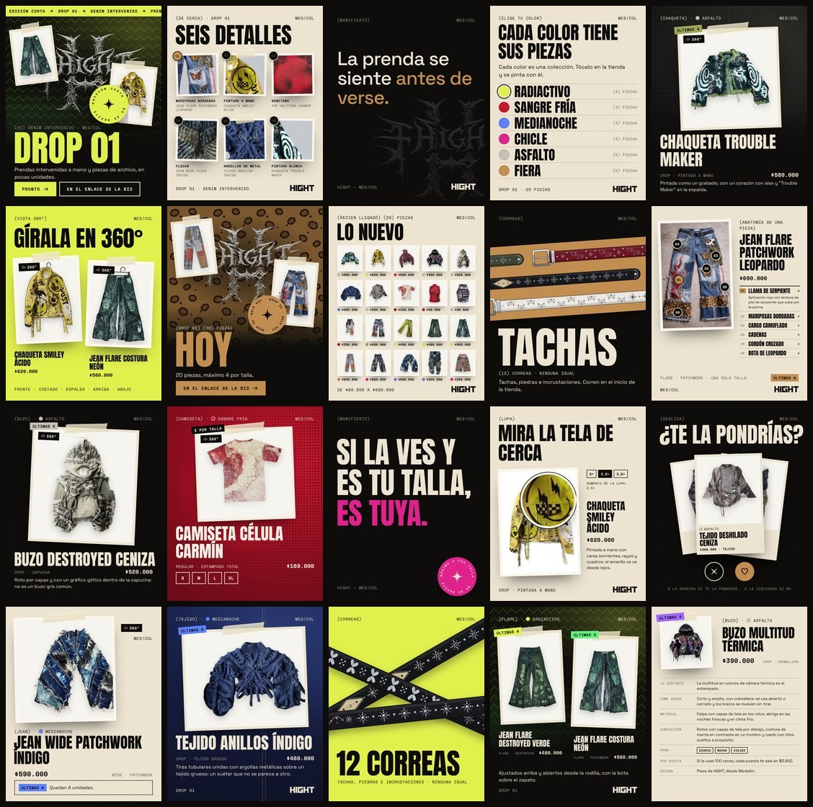

# Posts de Instagram



Los 20 posts del lanzamiento del Drop 01, en 1080 × 1350 (el vertical del feed), con el estilo de la página: carbón,
hueso y los seis colores de la tienda con sus texturas (Radiactivo, Sangre Fría, Medianoche, Chicle, Asfalto y Fiera),
Anton para los titulares, Space Grotesk para el texto y Space Mono para las marquillas y los precios, las prendas como
copias impresas con cinta, el sello de la estrella, la franja de texto y el logo de la marca. Cada post toma una parte
de la página: la portada, Lo nuevo, Elige tu color, la anatomía del jean, la lupa, ¿Te la pondrías?, la franja de las
correas, el manifiesto y la ficha con los datos de la pieza.

| Archivo | Para qué |
| --- | --- |
| `posts/01.jpg` a `20.jpg` | Los posts listos para subir, en el orden de publicación. |
| `textos.md` | El pie de foto de cada post y de cada reel, el día en que sale y la bio sugerida. |
| `posts.html` | Los 20 posts armados en una página; de acá salen los JPG. |
| `imagenes/` | Las prendas recortadas, la espalda de la Chaqueta Trouble Maker, dos fotos completas, los seis detalles de cerca y dos prendas en 3D. |
| `preparar.py` | Arma `imagenes/` a partir de copias de las fotos de la tienda. |
| `render.js` | Saca los JPG de `posts.html`. |

## Orden

El feed alterna carbón con hueso o un color, así que en la cuadrícula del perfil (tres columnas) queda un tablero.
Seis posts salen antes del lanzamiento, dos el mismo día y doce después, uno por día. Las fechas propuestas, con el
lanzamiento el jueves 12 de noviembre de 2026 a las 8:00 p. m., están en `textos.md`.

| Post | Día | Fondo | Qué muestra |
| --- | --- | --- | --- |
| 01 | −6 | carbón, textura de Radiactivo | DROP 01 como la portada: el logo, dos copias con cinta y el sello |
| 02 | −5 | hueso | Seis detalles de cerca, cada uno de una prenda, con su número |
| 03 | −4 | carbón | *La prenda se siente antes de verse.*, con el logo detrás |
| 04 | −3 | hueso | Cada color tiene sus piezas: los seis colores y cuántas piezas tiene cada uno |
| 05 | −2 | carbón, textura de Asfalto | Chaqueta Trouble Maker, como su tarjeta en la tienda |
| 06 | −1 | ácido | Gírala en 360°: dos prendas en 3D en su percha |
| 07 | 0 | carbón, textura de Fiera | HOY, con el logo, dos copias y el sello |
| 08 | 0 | hueso | Lo nuevo: las 20 piezas con su color y su precio |
| 09 | +1 | carbón | Las correas en la franja de color, como en el inicio, y TACHAS |
| 10 | +2 | hueso | Anatomía del Jean Flare Patchwork Leopardo, con sus seis detalles numerados |
| 11 | +3 | carbón | Buzo Destroyed Ceniza |
| 12 | +4 | carmín, textura de Sangre Fría | Camiseta Célula Carmín, con sus cuatro tallas |
| 13 | +5 | carbón | *Si la ves y es tu talla, es tuya.* |
| 14 | +6 | hueso | Mira la tela de cerca: la lupa sobre la Chaqueta Smiley Ácido |
| 15 | +7 | carbón | ¿Te la pondrías?, con el Tejido Deshilado Ceniza |
| 16 | +8 | hueso | Jean Wide Patchwork Índigo, como en su ficha |
| 17 | +9 | carbón, textura de Medianoche | Tejido Anillos Índigo |
| 18 | +10 | ácido | Tres correas cruzadas de cerca |
| 19 | +11 | carbón, textura de Radiactivo | Jean Flare Destroyed Verde y Jean Flare Costura Neón |
| 20 | +12 | hueso | Los datos de la pieza del Buzo Multitud Térmica, como en su ficha |

Los precios, las unidades, los colores, los cortes y los textos de cada prenda son los de la tienda del 23 de octubre
de 2026 (máximo 4 por talla; la camiseta, 3 por talla). Si cambian, se cambian en `posts.html` y en `textos.md`, y se
vuelven a sacar los JPG.

## Volver a generar

Requiere Python 3 con Pillow y NumPy, y Node con Playwright (Chromium).

1. Las imágenes salen de la carpeta de trabajo que arma el generador 360 de `bocetos/vector/generador/` (la que tiene
   `productos/<prenda>/foto.jpg` y `foto-mascara.png`; las máscaras salen de `recorte.py` y, en el Jean Wide Fleco
   Índigo y la Chaqueta Blood Rose, de su propio recorte). Las fotos de la tienda no se tocan: se trabaja sobre copias, y
   al recortar se le quita al borde el blanco del fondo para que no quede un halo. Las dos prendas en 3D son capturas
   del visor 360 de la tienda.

   ```bash
   python3 bocetos/instagram/preparar.py <carpeta de trabajo del 360>
   ```

2. Los JPG salen de `posts.html`, servido desde la raíz del repo (usa las tipografías, el logo, el grano y las correas
   de `assets/`):

   ```bash
   python3 -m http.server 8783
   node bocetos/instagram/render.js http://127.0.0.1:8783/bocetos/instagram/posts.html
   ```

Las prendas que la foto original corta por un lado (el Jean Wide Patchwork Índigo, el Tejido Anillos Índigo y el Jean
Flare Dragón Ácido) van con ese lado contra el borde de la foto, para que el corte se vea a propósito. La foto del Jean
Wide Fleco Índigo lo corta arriba, un poco encima de la entrepierna, y abajo, donde la pierna cae sobre el zapato: va
con los dos bordes contra la foto, y su recorte deja el jean con los muslos y la entrepierna (que la sombra deja casi
negra), sin el piso, los zapatos ni el fondo que se ve entre las piernas.
