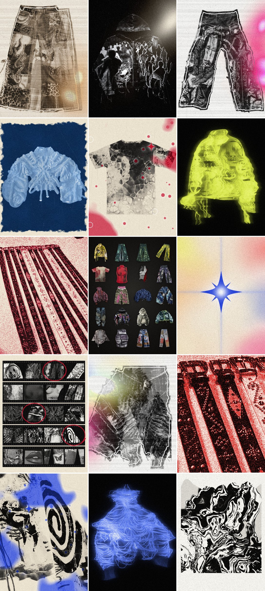

# Lanzamiento sin texto



Una campaña nueva para el Drop 01 sin una sola letra: ni en los posts, ni en los reels, ni en los pies de foto. La
historia la cuentan las imágenes.

## La idea

Un cuarto oscuro: el Drop 01 se revela en público.

- **Antes** (seis días): solo se ve la luz y la textura de las prendas, pasadas por procesos de copia (mármol,
  fantasma, negativo, luz roja, escaneo y una hoja de contactos). Cada día se ve un poco más.
- **El día**: al mediodía, la estrella. A las 8:00 p. m., cuando abre la tienda, las 20 piezas limpias. Es el revelado.
- **Después** (siete días): las correas y, día por día, cada colección con su proceso y sus prendas una por una.

Sale del manifiesto de la marca: «La plata es nuestra piel; el azul, la luz que se cuela de noche». La plata son el
blanco y negro, el escaneo y la copia. El azul es la luz de noche: el fantasma, la tinta del negativo y la estrella.
La luz que se cuela son las fugas de luz, en los seis colores de las colecciones.

## Las referencias

| Referencia | Qué se tomó | Dónde está |
| --- | --- | --- |
| El remolino en blanco y negro | La prenda derretida en vetas negras y blancas, sobre una página con el borde de arriba ondulado | Post 01 y reel adelanto |
| El ojo en negativo con tinta azul | El negativo sobre papel hueso, con manchones de tinta y su halo blanco, anillos sueltos y un destello en forma de estrella | Posts 03 y 11 (en rojo) y reel adelanto |
| Las montañas con fugas de luz | El escaneo en blanco y negro, con bandas, polvo, la línea blanca que sigue la silueta y las fugas de luz | Posts 05, 13 y 15 y reel adelanto |
| La figura azul que se corre | La prenda como luz que se arrastra sobre negro, con líneas de barrido | Posts 02 y 10 (en ácido) y reel adelanto |
| La pieza roja de grano suelto | Rojo, negro y blanco en puntos sueltos, con relieve en los bordes | Posts 04 y 09 y reel correas |
| El feed de Undergold | Campañas como capítulos, imágenes a sangre sin letras encima, producto mezclado con atmósfera, carruseles por pieza | Toda la campaña |

Además se sumaron dos procesos que siguen la misma idea: la cianotipia, en el azul de Prusia del post 12, y la plata
de noche, en el blanco y negro del post 14.

## Lo que se queda de la marca

- **Colores:** plata, noche y azul, como dice el manifiesto, sobre el carbón y el hueso de la marca. Los seis colores
  de las colecciones entran como fugas de luz, y cada colección tiene el suyo en su post.
- **La estrella como única firma:** es la del sello y la franja de la tienda. El logo tiene letras, así que no aparece.
- **El tablero:** los posts alternan papel (claros) y noche (oscuros), así que la cuadrícula queda en tablero, como en
  la campaña anterior.
- **Grano y copia:** el grano y el polvo de las copias impresas, que ya son parte de la marca.
- **Los reels cierran como siempre:** la estrella cae de arriba y golpea con el sonido de la marca, el golpe grave y
  las tres campanas en re mayor. La música es propia, la misma psicodelia de sintetizadores.
- **Las prendas reales:** todo sale de copias de las fotos de la tienda. Las fotos originales no se tocan.

## Calendario

Es el mismo lanzamiento propuesto: el jueves 12 de noviembre de 2026 a las 8:00 p. m., hora de Colombia. Los posts
salen a las 12:00 m. y los reels a las 7:00 p. m.

| Día | Fecha | 12:00 m. | 7:00 p. m. |
| --- | --- | --- | --- |
| −6 | viernes 6 de noviembre | 01 · Mármol: el Buzo Destroyed Ceniza derretido | |
| −5 | sábado 7 | 02 · Fantasma azul: la Chaqueta Blood Rose | |
| −4 | domingo 8 | 03 · Negativo con tinta azul y la estrella: la espiral de la Chaqueta Trouble Maker | Reel adelanto |
| −3 | lunes 9 | 04 · Luz roja: las hebillas de las correas | |
| −2 | martes 10 | 05 · Escaneo con fugas de luz: los dos jeans wide de Medianoche | |
| −1 | miércoles 11 | 06 · Hoja de contactos: un acercamiento de cada una de las 20 prendas, tres marcadas en rojo | |
| 0 | jueves 12 | 07 · La estrella quemada en el papel | Reel revelado; a las 8:00 p. m. abre la tienda y sale el 08 · Las 20 piezas |
| +1 | viernes 13 | 09 · Las doce correas en tinta roja | Reel correas |
| +2 | sábado 14 | 10 · Radiactivo, en luz ácida (carrusel de 5) | |
| +3 | domingo 15 | 11 · Sangre Fría, en negativo rojo (carrusel de 4) | |
| +4 | lunes 16 (festivo) | 12 · Medianoche, en cianotipia (carrusel de 4) | |
| +5 | martes 17 | 13 · Chicle, escaneado con luz magenta (carrusel de 4) | |
| +6 | miércoles 18 | 14 · Asfalto, en plata de noche (carrusel de 7) | |
| +7 | jueves 19 | 15 · Fiera, escaneado y virado al color del leopardo (carrusel de 3) | |

En cada carrusel, la primera imagen es el proceso y las siguientes son las prendas limpias sobre carbón, una por foto
(`posts/10-2.jpg`, `10-3.jpg`, ...). La Chaqueta Trouble Maker va de frente y de espalda.

## Cómo publicarla sin texto

- **Posts:** sin pie de foto ni hashtags. Se publican en orden para que se mantenga el tablero.
- **Cuadrícula:** el perfil muestra cada post en 3:4, así que le quita unos 34 píxeles a cada lado; al abrirlo se ve
  entero. Los posts van en 4:5 (1080 × 1350), que es lo que se recomienda subir, y no tienen nada importante en esas
  orillas. La vista previa ya muestra ese recorte.
- **Venta:** a cada prenda limpia del carrusel se le pone la etiqueta de su producto, que es un botón y no una letra
  en la imagen. Para eso la tienda tiene que estar conectada con Instagram por el canal de Facebook e Instagram de
  Shopify. Eso lo hace quien administra la tienda.
- **Bio:** durante la campaña puede quedar solo el enlace de la tienda.
- **Reels:** se sube la versión con música (`reels/<reel>.mp4`). Si prefieres una canción de la biblioteca de
  Instagram, sube la versión solo con efectos (`reels/<reel>-sin-musica.mp4`) y pónsela encima. Para no romper el
  tablero, quita los reels de la cuadrícula desde su menú; siguen en la pestaña de reels.
- **Texto alternativo:** es opcional. Instagram deja llenarlo en la configuración avanzada de cada post; no se ve en
  el post y sirve a quien usa lector de pantalla.

## Las letras que quedan

- **Estampados de las prendas:** algunas los traen. El short dice «EZTACY», la Chaqueta Smiley Ácido tiene palabras
  pintadas y la espalda de la Chaqueta Trouble Maker dice su nombre. No se tocaron, porque son el producto. En los
  acercamientos y en los procesos se eligieron partes sin letras.
- **Etiqueta del Top Crop Rostros:** la del cuello dice «SHEIN». En su foto limpia queda fuera de cuadro. En la foto
  de su ficha en la tienda sí se ve.

## Archivos

| Archivo | Qué es |
| --- | --- |
| `posts/01.jpg` a `15.jpg` | Los 15 posts en 1080 × 1350, en orden de publicación |
| `posts/<post>-<n>.jpg` | Las prendas limpias de cada carrusel |
| `reels/adelanto.mp4`, `revelado.mp4`, `correas.mp4` | Los tres reels en 1080 × 1920, con música propia |
| `reels/<reel>-sin-musica.mp4` | Los mismos, solo con los efectos, para ponerles una canción de Instagram |
| `procesos.py` | Los procesos de imagen: negativo, mármol, fantasma, luz roja, cianotipia, escaneo, plata y la foto limpia |
| `posts.py` | Arma los posts y los carruseles |
| `reels.py` | Arma los reels y su sonido (con `../reels/sonido.py`) |
| `fuentes/correas-foto.jpg` | Una copia de la foto de las correas, de donde salen las hebillas y la tinta roja |
| `vista-previa.jpg` | La cuadrícula del perfil con los 15 posts, recortados a 3:4 como los muestra Instagram |

## Volver a generarlos

Requiere Python 3 con NumPy, Pillow y OpenCV (`opencv-python-headless`), y ffmpeg para los reels. Las prendas salen de
los recortes de `../instagram/imagenes/`, que a su vez son copias de las fotos de la tienda. Desde la raíz del repo:

```bash
python3 bocetos/lanzamiento-sin-texto/posts.py            # los 15 posts y los carruseles (o solo algunos: posts.py 3 7)
python3 bocetos/lanzamiento-sin-texto/reels.py            # los tres reels (o uno: reels.py correas)
```

Los posts tardan menos de un minuto y, cuando están los 15, también rehacen la vista previa. Cada reel tarda de uno a
cuatro minutos, porque cada cuadro se procesa entero.
