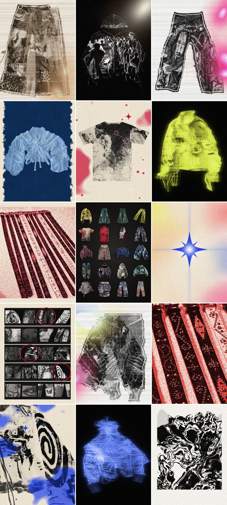

# Lanzamiento sin texto



Una campaña nueva para el Drop 01 sin una sola letra: ni en los reels, ni en los posts, ni en los pies de foto. La
historia la cuentan las imágenes. Casi todo es reel: de las 17 publicaciones, 15 son reels y 2 son posts (88 % y
12 %).

## La idea

Un cuarto oscuro: el Drop 01 se revela en público.

- **Antes** (seis días): un reel por día con un proceso de copia: mármol, fantasma, negativo, luz roja, escaneo y
  hoja de contactos. Solo se ve la luz y la textura de las prendas, y cada día se ve un poco más. El día −4 sale
  además el adelanto, con los seis procesos al golpe.
- **El día**: al mediodía, el post de la estrella. A las 7:00 p. m., el reel del revelado, donde las prendas aparecen en
  la cubeta. A las 8:00 p. m., cuando abre la tienda, el post de las 20 piezas limpias, con una imagen por colección.
- **Después** (siete días): el reel de las correas y, día por día, un reel por colección: su proceso y, al golpe, sus
  prendas limpias una por una.

Sale del manifiesto de la marca: «La plata es nuestra piel; el azul, la luz que se cuela de noche». La plata son el
blanco y negro, el escaneo y la copia. El azul es la luz de noche: el fantasma, la tinta del negativo y la estrella.
La luz que se cuela son las fugas de luz, en los seis colores de las colecciones.

## Las referencias

| Referencia | Qué se tomó | Dónde está |
| --- | --- | --- |
| El remolino en blanco y negro | La prenda derretida en vetas negras y blancas, en una página con el borde de arriba ondulado | Reels mármol y adelanto |
| El ojo en negativo con tinta azul | El negativo sobre papel hueso, con manchones de tinta y su halo blanco, anillos sueltos y un destello en forma de estrella | Reels negativo, carmín (en rojo) y adelanto |
| Las montañas con fugas de luz | El escaneo en blanco y negro, con bandas, polvo, la línea blanca que sigue la silueta y las fugas de luz | Reels escaneo, magenta, leopardo y adelanto |
| La figura azul que se corre | La prenda como luz que se arrastra sobre negro, con líneas de barrido | Reels fantasma, ácido (en ácido) y adelanto |
| La pieza roja de grano suelto | Rojo, negro y blanco en puntos sueltos, con relieve en los bordes | Reels luz roja y correas |
| El feed de Undergold | Campañas como capítulos, imágenes a sangre sin letras encima, producto mezclado con atmósfera, una pieza por toma | Toda la campaña |

Además se sumaron dos procesos que siguen la misma idea: la cianotipia, en el azul de Prusia del reel índigo, y la
plata de noche, en el blanco y negro del reel ceniza.

## Lo que se queda de la marca

- **Colores:** plata, noche y azul, como dice el manifiesto, sobre el carbón y el hueso de la marca. Los seis colores
  de las colecciones entran como fugas de luz, y cada colección tiene el suyo en su reel.
- **La estrella como única firma:** es la del sello y la franja de la tienda. El logo tiene letras, así que no aparece.
- **El tablero:** la cuadrícula del perfil tiene 15 cuadros (13 portadas de reels y los dos posts) que alternan papel
  (claros) y noche (oscuros), así que queda en tablero. El adelanto y el revelado salen de la cuadrícula para no
  romperlo.
- **Grano y copia:** el grano y el polvo de las copias impresas, que ya son parte de la marca.
- **Los reels cierran como siempre:** la estrella cae de arriba y golpea con el sonido de la marca, el golpe grave y
  las tres campanas en re mayor. En los reels de noche cae sobre negro; en los de papel se quema en el hueso, como el
  post de la estrella. La música es propia, la misma psicodelia de sintetizadores.
- **Las prendas reales:** todo sale de copias de las fotos de la tienda. Las fotos originales no se tocan.

## Calendario

Es el mismo lanzamiento propuesto: el jueves 12 de noviembre de 2026 a las 8:00 p. m., hora de Colombia. Lo de cada día
sale a las 12:00 m.; el adelanto y el revelado, a las 7:00 p. m.

| Día | Fecha | 12:00 m. | 7:00 p. m. |
| --- | --- | --- | --- |
| −6 | viernes 6 de noviembre | Reel mármol: el Buzo Destroyed Ceniza derretido | |
| −5 | sábado 7 | Reel fantasma: la Chaqueta Blood Rose como luz azul | |
| −4 | domingo 8 | Reel negativo: gotas de tinta azul y la espiral de la Chaqueta Trouble Maker | Reel adelanto (fuera de la cuadrícula) |
| −3 | lunes 9 | Reel luz roja: las hebillas de las correas | |
| −2 | martes 10 | Reel escaneo: los dos jeans wide de Medianoche con fugas de luz | |
| −1 | miércoles 11 | Reel hoja de contactos: un acercamiento de cada una de las 20 prendas, tres marcadas en rojo | |
| 0 | jueves 12 | Post 07: la estrella quemada en el papel | Reel revelado (fuera de la cuadrícula); a las 8:00 p. m. abre la tienda y sale el post 08: las 20 piezas (carrusel de 7) |
| +1 | viernes 13 | Reel correas: las doce en la luz roja | |
| +2 | sábado 14 | Reel ácido: Radiactivo en luz ácida y sus cuatro prendas | |
| +3 | domingo 15 | Reel carmín: Sangre Fría en negativo rojo y sus tres prendas | |
| +4 | lunes 16 (festivo) | Reel índigo: Medianoche en cianotipia y sus tres prendas | |
| +5 | martes 17 | Reel magenta: Chicle escaneado con luz magenta y sus tres prendas | |
| +6 | miércoles 18 | Reel ceniza: Asfalto en plata de noche y sus seis fotos | |
| +7 | jueves 19 | Reel leopardo: Fiera escaneado y virado al leopardo, y sus dos prendas | |

En el reel ceniza, la Chaqueta Trouble Maker sale de frente y de espalda. El carrusel del post 08 lleva primero las 20
piezas juntas y después una imagen por colección (`posts/08-2.jpg` a `08-7.jpg`).

## Cómo publicarla sin texto

- **Reels:** se sube la versión con música (`reels/<reel>.mp4`). Si prefieres una canción de la biblioteca de
  Instagram, sube la versión solo con efectos (`reels/<reel>-sin-musica.mp4`) y pónsela encima.
- **Portadas:** a cada reel se le sube su portada (`portadas/<reel>.jpg`) al editar la portada, desde el carrete. En la
  cuadrícula se ve el centro en 3:4; las portadas están hechas para eso, así que no hay que mover el recorte.
- **Fuera de la cuadrícula:** el adelanto y el revelado se quitan de la cuadrícula del perfil desde los tres puntos
  del reel, para que el tablero no se rompa. Siguen en la pestaña de reels.
- **Posts:** sin pie de foto ni hashtags. Los posts van en 4:5 (1080 × 1350), que es lo que se recomienda subir; la
  cuadrícula les quita unos 34 píxeles a cada lado y no tienen nada importante en esas orillas.
- **Venta:** a cada prenda se le pone la etiqueta de su producto, que es un botón y no una letra en la imagen: en el
  carrusel del post 08 (cada imagen de colección con sus prendas) y en los reels de las colecciones. Para eso la
  tienda tiene que estar conectada con Instagram por el canal de Facebook e Instagram de Shopify. Desde 2025 el botón
  lleva a la tienda, no se paga dentro de Instagram, y la opción no está en todos los países; si no aparece, el enlace
  de la bio lleva a la tienda.
- **Orden:** todo se publica en el orden del calendario, para que el tablero salga como en la vista previa.
- **Bio:** durante la campaña puede quedar solo el enlace de la tienda.
- **Texto alternativo:** es opcional. Instagram deja llenarlo en la configuración avanzada de cada post; no se ve en
  el post y sirve a quien usa lector de pantalla.

## Las letras que quedan

- **Estampados de las prendas:** algunas los traen. El short dice «EZTACY», la Chaqueta Smiley Ácido tiene palabras
  pintadas y la espalda de la Chaqueta Trouble Maker dice su nombre. No se tocaron, porque son el producto, y salen
  en las fotos limpias de los reels de las colecciones y del post 08. En los acercamientos y en los procesos se
  eligieron partes sin letras.
- **Etiqueta del Top Crop Rostros:** la del cuello dice «SHEIN». En todas las imágenes de la campaña esa parte de
  arriba se corta y se funde en la sombra. En la foto de su ficha en la tienda sí se ve.

## Archivos

| Archivo | Qué es |
| --- | --- |
| `reels/<reel>.mp4` | Los 15 reels en 1080 × 1920, con música propia: marmol, fantasma, negativo, adelanto, luz-roja, escaneo, contactos, revelado, correas, acido, carmin, indigo, magenta, ceniza y leopardo |
| `reels/<reel>-sin-musica.mp4` | Los mismos, solo con los efectos, para ponerles una canción de Instagram |
| `portadas/<reel>.jpg` | La portada de cada reel, en 1080 × 1920 |
| `posts/07.jpg` y `08.jpg` | Los dos posts, en 1080 × 1350 |
| `posts/08-2.jpg` a `08-7.jpg` | El resto del carrusel del post 08: una imagen por colección con sus prendas |
| `procesos.py` | Los procesos de imagen: negativo, mármol, fantasma, luz roja, cianotipia, escaneo, plata y la foto limpia |
| `posts.py` | Las imágenes de los 15 cuadros, los dos posts, el carrusel, las portadas y la vista previa |
| `reels.py` | El adelanto, el revelado y el de las correas, y lo que usan todos los reels: el grano, el cierre de la estrella, el sonido (con `../reels/sonido.py`) y ffmpeg |
| `reels_diarios.py` | Los 12 reels de los demás cuadros: los seis de antes del lanzamiento y los seis de las colecciones |
| `fuentes/correas-foto.jpg` | Una copia de la foto de las correas, de donde salen las hebillas y la tinta roja |
| `vista-previa.jpg` | La cuadrícula del perfil con los 15 cuadros, recortados a 3:4 como los muestra Instagram |

## Volver a generarlos

Requiere Python 3 con NumPy, Pillow y OpenCV (`opencv-python-headless`), y ffmpeg para los reels. Las prendas salen de
los recortes de `../instagram/imagenes/`, que a su vez son copias de las fotos de la tienda. Desde la raíz del repo:

```bash
python3 bocetos/lanzamiento-sin-texto/posts.py             # los posts, el carrusel, las portadas y la vista previa
python3 bocetos/lanzamiento-sin-texto/reels.py             # el adelanto, el revelado y el de las correas (o uno: reels.py correas)
python3 bocetos/lanzamiento-sin-texto/reels_diarios.py     # los 12 reels de los cuadros (o algunos: reels_diarios.py marmol ceniza)
```

Las imágenes fijas tardan menos de un minuto. Cada reel tarda de uno a cuatro minutos, porque cada cuadro se procesa
entero.
