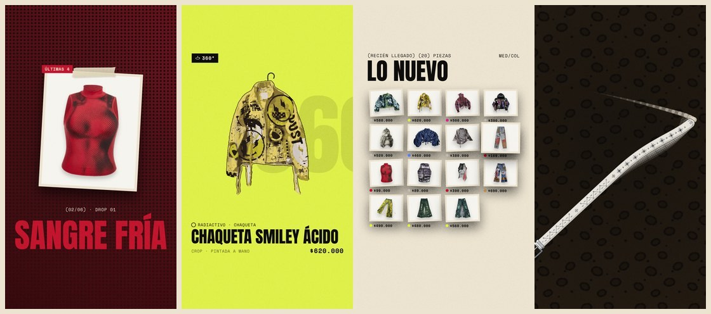

# Reels de Instagram



Cuatro videos verticales para el lanzamiento, en 1080 × 1920 y a 30 cuadros por segundo, con el mismo estilo de la
página y de los posts: carbón, hueso y los seis colores con sus texturas, Anton, Space Grotesk y Space Mono, copias
impresas con cinta, el sello y las franjas de texto. Van con cortes al ritmo de los golpes, sacudidas y destellos, y
todos cierran igual: el logo cae de arriba, golpea, y debajo aparece el anuncio del lanzamiento con una pregunta para
la comunidad y los seis colores de la tienda.

| Video | Dura | Qué pasa | Cierre | Día |
| --- | --- | --- | --- | --- |
| `adelanto.mp4` | 9,6 s | Entran las franjas de texto, pasan los seis colores con una prenda cada uno, «¿De qué color eres?» y DROP 01 letra por letra. | PRONTO · ¿De qué color eres? | −4 |
| `giro.mp4` | 13,4 s | «360°» gira y entra; la Chaqueta Smiley Ácido, el Jean Flare Costura Neón y el Buzo Multitud Térmica dan una vuelta entera en su percha, con paneos rápidos entre una y otra. | MAÑANA · ¿Cuál te pondrías? | −1 |
| `hoy.mp4` | 9,8 s | Cuenta regresiva 3, 2, 1 en tres colores, HOY de golpe y las 20 piezas cayendo sobre la mesa. | SALE HOY · Si es tu talla, es tuya | 0 |
| `correas.mp4` | 8,4 s | Las correas corren en las franjas del inicio cada vez más rápido, TACHAS, y al final una correa cruza la pantalla como un látigo: revienta, la pantalla se parte en dos y cae el logo. | YA EN LA TIENDA · ¿Cuál es la tuya? | +1 |

Los días son los mismos de `../instagram/textos.md`, donde también están los pies de foto de cada reel. Si quieres
conservar el tablero de la cuadrícula del perfil, quita los reels de la cuadrícula desde su menú: siguen en la pestaña
de reels.

## Sonido

Cada video trae música propia y efectos, hechos aquí mismo con `sonido.py` (sin canciones de nadie, así que Instagram
no los silencia por derechos de autor). La música es una base en re menor con bombo, palmas, platillos, bajo 808 y
acordes, al tempo de los cortes de cada video: una negra por color en el adelanto, seis por prenda en el giro, una
semicorchea por cada pieza que cae en hoy y platillos que se aceleran con las franjas en correas, que se calla justo
antes del latigazo. Cuando el logo cae, en los cuatro suena lo mismo: el golpe grave y tres campanas (re, fa, la), que
son el sonido de la marca. Encima van los efectos: un golpe en cada corte, el aire de las franjas y los paneos, la
subida antes del logo, los tics de las letras y de las piezas, y el chasquido del látigo; en cada golpe la música baja
un poco para que el golpe se sienta.

Se pueden subir tal cual. Si se prefiere una canción de Instagram, se baja el volumen del audio original en el editor
de Instagram y los golpes quedan debajo de la canción.

## Cómo se arman

`reels.html?r=<reel>` dibuja cada cuadro en un lienzo, siempre igual para el mismo número de cuadro; `giro` usa el
mismo 3D del visor de la tienda (`assets/hight-ropa.js` y three.js). `cuadros.js` guarda los cuadros como PNG y los
efectos de sonido en `sonido.json`, `sonido.py` arma el sonido y ffmpeg junta todo. Requiere Node con Playwright
(Chromium), Python 3 con NumPy y ffmpeg; desde la raíz del repo:

```bash
python3 -m http.server 8783
node bocetos/reels/cuadros.js http://127.0.0.1:8783/bocetos/reels/reels.html correas   # deja cuadros-correas/
python3 bocetos/reels/sonido.py cuadros-correas/sonido.json sonido-correas.wav
ffmpeg -framerate 30 -i cuadros-correas/%04d.png -i sonido-correas.wav -c:v libx264 -preset slow -crf 22 \
  -pix_fmt yuv420p -profile:v high -level 4.2 -c:a aac -b:a 192k -shortest -movflags +faststart \
  bocetos/reels/correas.mp4
```

Los nombres de los reels son `adelanto`, `giro`, `hoy` y `correas`; las carpetas de cuadros y el WAV se pueden borrar
después. Las prendas salen de `../instagram/imagenes/`; el logo, las tipografías, el grano y las correas, de `assets/`.
El grano cambia cada dos cuadros y es de 2 px, para que la compresión de Instagram no lo vuelva bloques.
