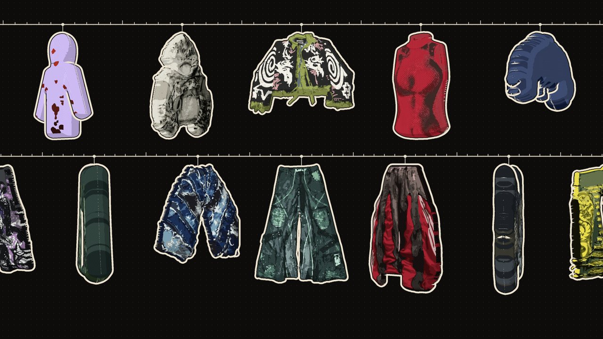

# Video de campaña: En movimiento



Las 26 prendas dibujadas en vector, las mismas del visor 360, colgadas de dos rieles de tintorería. Arriba van
las prendas de arriba, abajo las de abajo, y los rieles corren en sentidos contrarios. Cada prenda da una vuelta
entera mientras cruza la pantalla: mira de frente al pasar por el centro, se queda un rato de frente y de espalda,
y pasa rápido por el costado. Los rieles son cintas métricas y cada gancho es una de sus marcas.

- 20 segundos en bucle exacto (el último cuadro empalma con el primero), 30 cuadros por segundo, 1920×1080, sin
  sonido.
- Sin letras: el texto lo pone la sección *Video de campaña* del tema. Abajo queda espacio para el titular y el
  botón, y en el teléfono, que muestra solo el centro, se ve una prenda de cada riel.
- Está en *Contenido > Archivos* como `hight-en-movimiento.mp4` y es el video de la sección *Video de campaña*
  del inicio.

## Cómo se arma

Desde la raíz del repo, con Playwright (Chromium) y ffmpeg:

```bash
python3 -m http.server 8791 &
node bocetos/video/cuadros.js "http://127.0.0.1:8791/bocetos/video/escena.html?aa=0&w=3840&h=2160&ss=2" 0 600
ffmpeg -framerate 30 -i cuadros/%04d.png -c:v libx264 -preset slow -crf 18 -pix_fmt yuv420p \
  -profile:v high -movflags +faststart -an hight-en-movimiento.mp4
```

`escena.js` usa los archivos 360 de `assets/` y three.js del tema. Cada cuadro se dibuja en 4K y se achica a 1080p,
para que los bordes salgan suaves (unos 2 segundos por cuadro). `escena.html` admite estos parámetros:

| Parámetro | Qué hace |
| --- | --- |
| `w`, `h` | Tamaño del dibujo (por defecto 1920×1080) |
| `ss` | Cuántas veces más grande se dibuja antes de achicarlo (2 con 3840×2160 da 1080p) |
| `aa=0` | Sin el suavizado de WebGL (con `ss=2` no hace falta y es más rápido) |
| `ease` | Cuánto se queda cada prenda de frente y de espalda (0 gira parejo; por defecto 0,3) |
| `line`, `sticker` | Grosor del trazo negro y del borde hueso |

Para cambiar el orden o la mezcla de prendas, edita `ROWS` arriba de `escena.js`.
